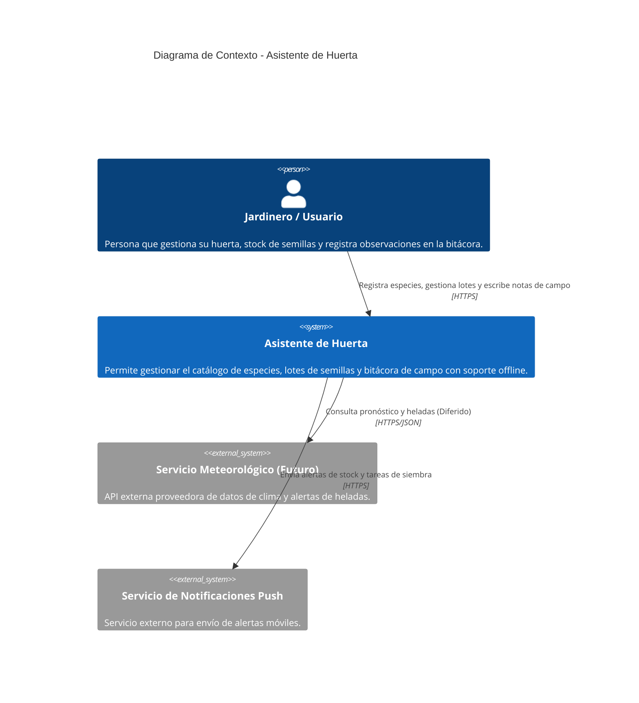
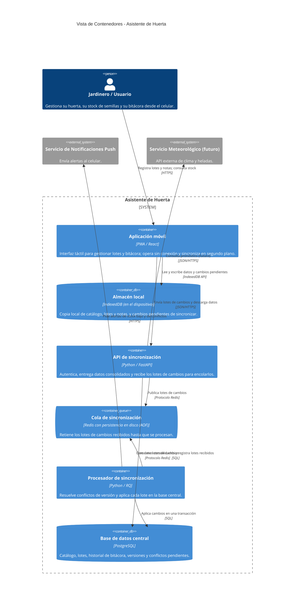
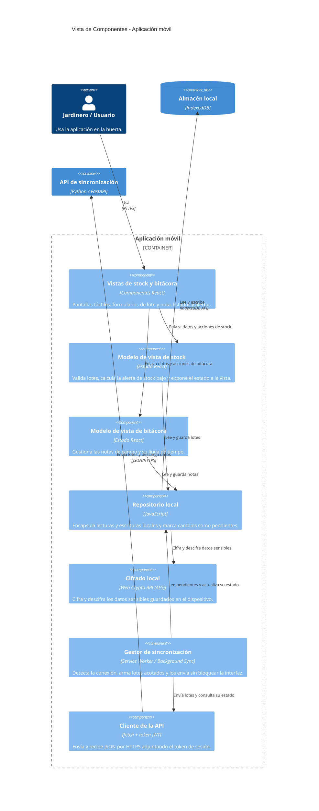

# Arquitectura

Definir la estructura arquitectónica del sistema Asistente de Huerta, transformando los escenarios de calidad y requerimientos funcionales en decisiones de diseño estructurales (contenedores, componentes, tácticas, estilos y patrones).
La arquitectura se especifica para los procesos principales definidos en la primer y segunda parte: Gestión de Stock de Semillas y Bitácora Personal, con sincronizacion diferida. El resto de las integraciones futuras (Servicio de Clima y Calendarios) se representan como sistemas externos o cajas negras.

Siglas:
* C4: Contexto, Contenedor, Componente, Código
* DA: Desición de arquitectura
* EC: Escenario de calidad
* PWA: Progressive Web App
* REST: Representational State Transfer

## Restricciones

* Restriccion tecnológica y de despliegue: La aplicacion debe funcionar en dispositivos moviles de gama baja/media, priorizando la ejecucion cliente (PWA/LocalFirst) usando IndexBD/SQLite Local y comunicacion por HTTPS/JSON con el backend.
* Restriccion del dominio/operación: Intermitencia o ausencia total de señal de internet en el campo. El núcleo operativo no puede depender de llamadas sincronas al servidor para la captura de datos.

## Contexto

Se recupera la visión de nivel 0 (Contexto) definida anteriormente. El usuario interactua con el sistema, y este se vincula con servicios externos de clima y notificaciones.

## Drivers Arquitectonicos
A partir de los escenarios de calidad y en el marco de las restricciones del proyecto, se identificaron los siguientes drivers que condicionan la estructura del sistema: 

* **EC-01 - Registro de datos en campo sin conectividad - Disponibilidad (Fiabilidad):** 100% de los registrs en la bitácora y lotes iniciados sin red se almacenan exitosamente en el dispositivo loca. Condiciona el estilo global del sistema, obliga a descartar una arquitectura web síncrona convencional e icorporar una arquitectura Cliente - Servidor Local - First, requiriendo un contenedor de Almacen Local (IndexDB) en la PWA del cliente.

* **EC-02 - Sincronizacion masiva en segundo plano - Eficiendia de Desempeño:** La interfaz maniene una respuesta fluida (<1s) mientras los datos acumulados se envial al resrvidor al recuperar conectividad. Obluga a incorporar un estilo Orientado a Eventos en la zona de sincronizacion, exigiendo la creacion de un contenedor de Cola de Tareas / Broker y componentes de procesamiento asincrono para no congelar el hilo principal del móvil.

* **EC-03: Tolerancia a conflictos de datos en sincronización - Capaciad de recuperación (Fiabilidad):** 0% de pérdida silenciosa de información ante divergencias de datos cargados en modo offline Obliga a diseñar un componente específico en el servidor (Motor de Resolución de Conflictos) y a estructurar las tablas de la base de datos central con esquemas de versionado y marcas de tiempo (timestamps).

* **EC-04 — Cifrado en tránsito y transaccionalidad de datos - Confidencialidad e Integridad (Seguridad):** 100% del tráfico de sincronización cifrado; las operaciones de actualización en base de datos son atómicas 100% completadas o revertidas por completo. Restringe los protocolos de comunicación entre el cliente y el servidor al uso exclusivo de HTTPS/TLS y condiciona la Capa de Acceso a Datos del servidor para implementar transacciones SQL atómicas mediante un ORM.

* **EC-05 — Extensibilidad modular para futuras integraciones -  Modularidad (Mantenibilidad):** Incorporación de nuevos módulos diferidos (Clima o Calendario Agrícola) con 0 modificaciones o regresiones sobre los módulos de Stock y Bitácora. Define la estructura interna del contenedor de la API Backend, obligando a adoptar el Patrón de Capas con dependencias unidireccionales y separación estricta entre controladores, servicios de negocio y persistencia.

## Estrategia de solución

### Selección de tácticas por driver

| Driver | Atributo libro (Bass) | Tácticas | Tácticas descartadas |
|---|---|---|---|
| EC-01 | Disponibilidad | Degradación controlada, operar offline localmente y manejo de excepciones | Redundancia activa: Descartada por complejidad y costo innecesario para uso personal |
|EC-02|Desempeño|Introducir concurrencia, ejecuta el proceso de sincronizacion en un hilo separado, y limita la cantidad de registros que se envian para no saturar la red|Aumentar recursos de hardware: Descartado por ser cliente movil de recurosos limitados|
|EC-03|Disponibilidad/Fiabilidad|Rolllback (vuelve al ultimo estado seguro), Transacciones y Mantenimiento de copias (versionado)|Ping y Eco: No resuelve la divergencia de datos ya guardados|
|EC-04|Seguridad|Cifrar datos (reposo/transitorio) y Transacciones atómicas|Detectar intrusion (IDS): Fuera del alcance del MVP de uso personal|
|EC-05|Modificabilidad|Encapsular, usar un intermediario y restringir dependencias|Diferir el enlace (Plugins dinamicos): Complejidad excesiva para la escala actual|

### Estilos arquitectónicos adaptados

**Estilo base global: *Cliente-Servidor desacoplado con persistencia local (Local-First)***
El Cliente (móvil/PWA) gestiona su propia interfaz y almacenamiento interno (IndexDB), garantizando respuest inmediata si red (EC-01). El Servidor actúa como punto central de sincronización y respaldo. 
Se sacrifican consistencias eventuales, los datos locales del cliente pueden diferir temporalmente de la base de datos remota hasta que se complete la sincronizacion.

**Estilo secundario: *por zona orientada a eventos (Broker)***
Aplica unicamente a la zona de sincronizacion en segundo plano. Se tiene mayor complejidad operativa al sumar un contenedor intermediario de cola (Redis). La PWA deposita el paquete de sincronizacion en el broker sin esperar el procesamiento sincrono bloqueante.

### Estilos por Contenedor

* En el contenedor Cliente (Aplicacion movil / PWA): 
    *   Patron MVVM (Modelo-vista-vista-modelo): Aisla la logica de interaccion de la UI y gestiona el estado reactivo local
    *   Patron repository local: Encapsula las lecturas y escrituras hacia IndexBD/SQLite local.

* En el Contenedor Servidor (API de Backend):
    *   Patrón Capas (o Hexagonal/Puertos y Adaptadores): Separa Presentación/Controladores, Servicios de Aplicación, Dominio (Stock/Bitácora) y Adaptadores de Acceso a Datos.
    *   Patrón Broker / Cola de Mensajes: Para encolar y procesar cambios pendientes o notificaciones pesadas de forma asincrónica.

### Aspectos transeversales

*   Autenticación y Autorización: Tokens JWT sobre HTTPS para validar la identidad en cada sincronización.
*   Manejo de Transacciones e Integridad: Transacciones locales y remotas (si la sincronización de un lote falla a la mitad, se ejecuta Rollback).
*   Auditoría y Registro: Campo last_modified y marcado de versión para resolución de conflictos (EC-03).
*   Gestión de excepciones: el Procesador de sincronización reintenta los lotes que fallan y registra como fallido el que no se puede aplicar, sin perderlo (EC-03).
*   Notificaciones: alertas push de stock bajo y de conflictos de sincronización, mediante un servicio externo.
*   Interoperabilidad: API REST con JSON sobre HTTPS.

**Aspectos transversales descartados:**

*   Instrumentación y monitoreo del servidor: descartado para el MVP de uso personal; los lotes fallidos quedan registrados y alcanzan para diagnosticar.
*   Auditoría completa de acciones por usuario: descartada porque cada usuario gestiona solo sus propios datos; el versionado con last_modified cubre lo que exige EC-03.

### Tabla de coberturas y sacrificios

|Driver|	Tácticas y Estilo/Patrón|	¿Cómo se cubre?	|Sacrificio Asumido|
|---|---|---|---|
|EC-01|	Degradación controlada / Cliente-Servidor LocalFirst|	La PWA lee y escribe en la base de datos local (IndexedDB) si no hay red.|	Complejidad de mantener lógica de almacenamiento duplicada (cliente y servidor).
|EC-02|	Introducir concurrencia / Broker y Web Workers|	El proceso de sincronización corre en un hilo secundario (Background Sync).	|Ligera latencia antes de que los cambios se reflejen en el servidor remoto.|
|EC-03|	Rollback y Versionado / Transacciones|	Servidor detecta timestamp/versiones y genera registros de revisión si hay conflicto.|	Requiere espacio adicional para guardar estados de conflicto para revisión del usuario.|
|EC-04|	Cifrado y Transacciones / HTTPS + AES|	Datos sensibles en el cliente se cifran en reposo y se transmiten vía HTTPS.|	Leve consumo adicional de CPU en el dispositivo móvil para cifrar/descifrar.|
|EC-05|	Encapsular / Arquitectura en Capas|	Cada módulo (Stock, Bitácora, Calendario futuro) expone interfaces limpias.|	Mayor cantidad de archivos y capas de indirección de código.|

## Vista de Contenedores

### Diagrama de contenedores

### Catalogo de la Vista de Contenedores

#### Catalogo de contenedores
|Contenedor	|Tecnología	|Responsabilidad|
|---|---|---|
|Aplicación PWA / Móvil	|React /JS / HTML5|	Interfaz de usuario táctil ergonómica. Permite operar sin conexión.|
|Almacén Local	|IndexedDB / Browser DB	|Guarda la copia local del catálogo, stock y notas pendientes de sincronizar.|
|API Backend de Sincronización|	Python / FastAPI	|Procesa las solicitudes síncronas, valida reglas de negocio y resuelve conflictos.|
|Cola de Tareas / Mensajes|	Redis / Queue	|Gestiona tareas asincrónicas y lotes de sincronización pesados.|
|Base de Datos Central|	PostgreSQL|	Almacenamiento persistente y relacional centralizado de todos los datos del usuario.|

#### Catalogo de Relaciones entre Contenedores
|Origen|Destino|Qué se comunica|Tipo|Protocolo|
|---|---|---|---|---|
|Jardinero|Aplicación PWA| Uso de la interfaz móvil| Persona $\rightarrow$ |ContenedorHTTPS / Táctil|
|Aplicación PWA| Almacén Local| Lectura y escritura de notas/lotes offline| Síncrono (Interno)| IndexedDB API|
| Aplicación PWA| API Backend| Envío de lotes guardados y sincronización| Síncrono / HTTPS| REST (JSON)|
|API Backend| Cola de Tareas| Encolado de lotes para procesamiento asincrónico| Asíncrono| Redis Protocol| 
|API Backend| Base de Datos Central| Consultas, actualizaciones y transacciones| Acceso a Datos| SQL|
|API Backend| Servicio Meteorológico| Consulta diferida de clima y alertas| Integración Externa| HTTPS / REST|

## Vista de Componentes
Se realiza un zoom sobre el contenedor princial de logica se servidor: API Backend de Sincronizacion

### Catalogo de la Vista de Componentes
|Componente| Tecnología| Responsabilidad| 
|---|---|---|
|Controladores REST| FastAPI Routers| Expone los endpoints HTTPS, procesa el cuerpo JSON de las solicitudes y retorna respuestas.|
|Módulo de Autenticación| JWT / Security Middleware| Valida la identidad del usuario y protege las rutas de la API.|
|Servicio de Gestión de Stock| Python| Ejecuta la lógica del módulo de Stock (RF01–RF04): alertas de stock crítico y bajas.|
|Servicio de Bitácora| Python| Administra el historial de notas de campo (RF05–RF06) y el versionado de entradas.|
|Motor de Resolución de Conflictos| Python| Detecta colisiones de fechas/versiones entre el cliente y el servidor (EC-03).|
|Capa de Acceso a Datos| SQLAlchemy ORM| Encapsula el acceso a la Base de Datos Central con soporte de transacciones atómicas.|
|Publicador de Eventos| Redis Client| Envía mensajes asincrónicos hacia la Cola de Tareas cuando se requieren procesamientos diferidos.|

## Recorrido de Historias de Usuario sobre las Vistas

Se demuestra el recorrido de dos Historias de Usuario clave del TP1 a través de la arquitectura definida (pasos Given-When-Then):

**HU-02: Registrar un nuevo lote de semillas (en modo offline)**
* Given (Dado que): El jardinero se encuentra en el campo sin conexión a internet y abre el formulario de lote.
* When (Cuando): Completa la cantidad y el año de cosecha y presiona "Guardar":
    * La Aplicación PWA valida los campos en el componente local.
    * La PWA escribe la transacción en el Almacén Local (IndexedDB) de forma síncrona.
    * La entrada queda marcada con estado "pendiente_sync".
* Then (Entonces): La UI confirma el guardado al usuario en $<1\text{ segundo}$, sin requerir llamadas de red.

**HU-08.B1: Sincronización diferida de notas de bitácora**
* Given (Dado que): La PWA detecta que se restableció la conexión a internet y existen 5 notas pendientes en el Almacén Local.
* When (Cuando): El proceso de sincronización en segundo plano se activa:
    * La PWA envía un lote HTTPS REST a los Controladores REST de la API.
    * Los Controladores invocan al Módulo de Autenticación para validar la sesión.
    * El Servicio de Bitácora pasa las notas al Motor de Resolución de Conflictos.
    * La Capa de Acceso a Datos abre una transacción SQL en la Base de Datos Central.
* Then (Entonces): La API responde 200 OK, la PWA actualiza el estado local a "sincronizado" y el usuario ve reflejado el estado en su pantalla.

## Desiciones de arquitectura (ADR/DA)

**DA-01 — Adopción de Arquitectura Local-First (PWA) para Persistencia Offline**
* Escenario que la motiva: EC-01 (Disponibilidad / Operación sin red en el campo).
* Contexto: El usuario opera en la huerta donde la señal 4G/Wi-Fi es nula o intermitente. Guardar datos no puede depender del servidor.
* Decisión:
    * Tácticas: Degradación controlada y Manejo de excepciones.
    * Estilo: Cliente-Servidor Desacoplado con almacén local en el cliente (Local-First).
    * Patrón: Repository Pattern en el cliente PWA sobre IndexedDB.
* Alternativas consideradas:
    * Aplicación Web Síncrona Tradicional: Descartada porque se bloquea totalmente al perder señal en el campo.
    * Desarrollo Nativo Móvil (Android/iOS): Descartado por costos y tiempo de desarrollo del equipo universitario.
* Consecuencias:
    * A favor: Garantiza el $100\%$ de disponibilidad para lecturas y escrituras en el jardín.
    * En contra: Requiere programar lógica de almacenamiento y sincronización duplicada en el cliente y servidor.
* Elementos afectados: Contenedores Aplicación PWA y Almacén Local.

**DA-02 — Desacoplamiento de la Sincronización mediante Cola de Tareas**
* Escenario que la motiva: EC-02 (Desempeño / Sincronización masiva en dispositivos de gama baja).
* Contexto: Al recuperar red tras días offline, la PWA puede enviar decenas de registros acumulados. Sincronizarlos de forma síncrona puede congelar la UI.
* Decisión:
    * Tácticas: Introducir concurrencia y Acotar colas.
    * Estilo: Orientado a Eventos / Procesamiento Asincrónico.
    * Patrón: Broker (Cola de mensajes con Redis).
* Alternativas consideradas:
    * Procesamiento Síncrono en el Endpoint HTTP: Descartado porque causa timeouts de red y congela la aplicación móvil.
* Consecuencias:
    * A favor: La PWA recupera el control de inmediato; la API responde rápido al usuario.
    * En contra: Se suma un contenedor de cola (Redis) a la infraestructura operativa.
* Elementos afectados: Contenedores API Backend y Cola de Tareas.

**DA-03 — Arquitectura en Capas en el Backend para Mantenibilidad Modular**
* Escenario que la motiva: EC-05 (Mantenibilidad / Incorporación modular de Calendario y Clima).
* Contexto: El proyecto utiliza un ciclo iterativo y sumará nuevos módulos en el futuro sin reescribir Stock o Bitácora.
* Decisión:
    * Tácticas: Encapsular y Restringir dependencias.
    * Estilo: Cliente-Servidor; Patrón: Capas (o Hexagonal) en la API Backend.
* Alternativas consideradas:
    * Arquitectura de Microservicios: Descartada por complejidad operativa excesiva para un equipo acotado.
* Consecuencias:
    * A favor: Permite agregar el módulo de Clima o Calendario agregando nuevos servicios/adaptadores sin modificar el código de Stock.
    * En contra: Agrega clases/interfaces intermedias (indirección).
* Elementos afectados: Componentes internos de la API Backend

## Trazabilidad 
|Escenario (TP2)| Atributo (ISO)| Tácticas Aplicadas| Estilo / Patrón| Decisión de Arquitectura| Elementos C4 Afectados|
|---|---|---|---|---|---|
|EC-01| Fiabilidad (3.1)| Degradación controlada| Local-First / Repository Local| DA-01| Contenedores: Aplicación PWA, Almacén Local.|
|EC-02| Eficiencia (1.2)| Concurrencia, acotar colas| Orientada a eventos / Broker| DA-02| Contenedores: API Backend, Cola de Tareas|
|EC-03| Fiabilidad (3.2)| Rollback, versionado| Repositorio / Transacciones| DA-01 / DA-02| Componente: Motor de Resolución de Conflictos.|
|EC-04| Seguridad (4.1)| Cifrado, transacciones| Capas / Cifrado reposo| DA-01 / DA-03| Componentes: Módulo Auth, Acceso a Datos.|
|EC-05| Mantenibilidad (5.1)| Encapsular, intermediario| Capas / Hexagonal| DA-03| Componentes: Servicios de Negocio (Stock/Bitácora).|