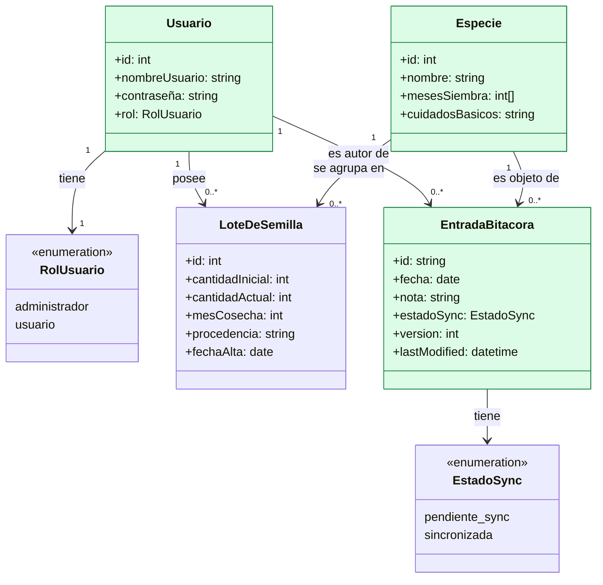
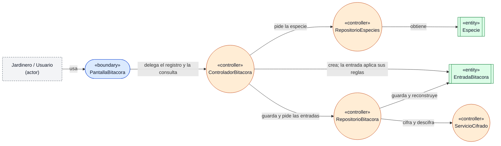

# Diseño detallado

**HU-08 — Registrar una observación en la bitácora.** TP4 de Ingeniería del Software 2026: diseño detallado, implementación y pruebas unitarias.

---

## 1. Introducción

### 1.1 Propósito

Este documento baja la arquitectura del TP3 al diseño de una historia de usuario y la lleva hasta el código y las pruebas. Reúne la ficha y el análisis de la HU, el diagrama de robustez, los diagramas de secuencia, el modelo de clases obtenido del código, la justificación del diseño, la implementación, las pruebas y la trazabilidad, con las secciones del Anexo de la consigna.

### 1.2 HU elegida y motivo de la elección

Se elige la *HU-08: Registrar una observación en la bitácora*, acotada a su flujo de captura offline, validación de reglas de negocio y visualización en la línea de tiempo local.

La bitácora de campo es la herramienta diaria del jardinero para registrar las observaciones de cultivo en la huerta sin depender de la conectividad. Además, se cumple con las tres condiciones exigidas: asociación directa a escenarios de calidad (EC-01: disponibilidad offline, y EC-04: seguridad en reposo), atraviesa los componentes internos del contenedor *Aplicación móvil* (Vistas de stock y bitácora, Modelos de vista, Repositorio local y Cifrado local) y está respaldada por la decisión de arquitectura DA-01: Local-First con patrón Repository.

**Qué tiene de relevante para el proyecto.** La bitácora es la razón de ser de la aplicación: el TP2 la describe como «años de observaciones personales» (escenario 4.1) y dice que la conectividad intermitente en el campo es «la condición de uso normal del usuario, no una excepción rara» (escenario 3.1). Si guardar una observación falla sin señal, la aplicación no sirve en el lugar donde más se la necesita; si lo guardado se puede leer en un teléfono perdido, se expone justo lo que más le importa a la persona. Es además la HU donde se encuentran, en una sola operación, las dos tácticas del TP3 que definen al cliente: operar sin red y cifrar en reposo.

**Alcance de este TP (el *slice*).**

| Entra | Queda afuera |
|---|---|
| Elegir la especie del catálogo local y ver su línea de tiempo | La sincronización con el servidor (Gestor de sincronización, API, Cola y Procesador del TP3): las entradas quedan pendientes |
| Cargar fecha y nota, validarlas y rechazar con su motivo | El inicio de sesión real (CU00): se simula la sesión de la cuenta precargada «usuario» |
| Guardar en el teléfono, cifrado y pendiente de sincronizar | Ofrecer el alta de una especie que no está (HU-06, flujo A1 de CU02): acá se rechaza |
| Ver la entrada nueva en la línea de tiempo | Editar o eliminar entradas (HU-09) |

### 1.3 Siglas

| Sigla | Significado |
|---|---|
| AES | *Advanced Encryption Standard*: algoritmo de cifrado simétrico |
| API | Interfaz de programación de aplicaciones |
| C4 | Contexto, Contenedor, Componente, Código: modelo de documentación de arquitectura |
| CA | Criterio de aceptación |
| CP | Caso de prueba |
| CU | Caso de uso |
| DA | Decisión de arquitectura |
| EC | Escenario de calidad |
| GCM | *Galois/Counter Mode*: modo de AES que además detecta si el dato cifrado fue modificado |
| GRASP | *General Responsibility Assignment Software Patterns*: patrones para asignar responsabilidades |
| HU | Historia de usuario |
| IA | Inteligencia artificial |
| MVVM | *Model-View-ViewModel*: modelo, vista y modelo de vista |
| PBKDF2 | *Password-Based Key Derivation Function 2*: función que deriva una clave a partir de una contraseña |
| PWA | *Progressive Web App*: aplicación web instalable que funciona sin conexión |
| RF | Requerimiento funcional |
| TP | Trabajo práctico |
| UML | Lenguaje unificado de modelado |
| UUID | *Universally Unique Identifier*: identificador que se genera sin coordinarse con un servidor |

---

## 2. Relación con la arquitectura

### 2.1 Tabla de coherencia

| Dimensión | Contenido |
|---|---|
| Funcionalidad | HU-08 Registrar observación en bitácora (CU02 / RF05; la línea de tiempo es RF10). Camino principal de alta offline con actualización de la línea de tiempo, y caminos de rechazo por datos inválidos (CU02-E1) o especie inexistente (CU02-A1). |
| Estructura | Contenedor: Aplicación móvil (PWA). Estilo: Local-First, cliente-servidor desacoplado con almacén local (DA-01). Patrones: MVVM + Repository local. Componentes que atraviesa: Vistas de stock y bitácora (Presentación), Modelos de vista de stock y bitácora (Control / Aplicación, **principal**), Repositorio local (Acceso a datos) y Cifrado local (Transversal). Llega al contenedor Almacén local (IndexedDB). |
| Calidad | **EC-01** (Fiabilidad, disponibilidad; escenario 3.1 del TP2): el 100% de los registros iniciados sin red se almacenan exitosamente en el dispositivo en menos de 1 s y quedan visibles como pendientes de sincronizar. Táctica: degradación controlada, operar offline (DA-01). **EC-04** (Seguridad, confidencialidad; escenario 4.1): protección de los datos personales en el dispositivo. Táctica: cifrar los datos en reposo (AES), con una clave que sale de la contraseña. En la trazabilidad del TP3, EC-04 está respaldado por DA-01 / DA-03. |
| Dominio | Entidades del modelo del TP1 que intervienen: Usuario, Especie y EntradaBitacora (ver 3.2). |
| Verificación | Pruebas unitarias en pytest simulando ausencia total de red: se verifica que el guardado local se complete en menos de 1 s, marque la entrada como `pendiente_sync`, la cifre al persistir y la exponga ordenada en la línea de tiempo de la especie. |

**De dónde sale el «menos de 1 s».** La medida del escenario 3.1 del TP2 es el 100% de las cargas, visibles como pendientes. El límite de tiempo lo agrega la ficha y sale del TP3, que en el recorrido de una carga sin conexión pide que la interfaz confirme el guardado en menos de 1 segundo. Se verifican las dos cosas.

### 2.2 Componentes y capas que atraviesa

| Componente o contenedor del TP3 | Capa | Qué hace en la HU | Elementos del diseño |
|---|---|---|---|
| Vistas de stock y bitácora | Presentación | Muestra el formulario y la línea de tiempo, y manda lo que escribe la persona | `PantallaBitacora` |
| Modelos de vista de stock y bitácora (**principal**) | Control / Aplicación, con su modelo de dominio | Coordina el registro y arma la línea de tiempo. Las reglas de una entrada viven en las entidades | `ControladorBitacora`; `EntradaBitacora` y `Especie` |
| Repositorio local | Acceso a datos | Lee el catálogo, guarda y lee las entradas, y marca lo pendiente | `RepositorioEspecies`, `RepositorioBitacora` |
| Cifrado local | Transversal | Cifra antes de guardar y descifra al leer | `ServicioCifrado` |
| Almacén local (contenedor) | Datos | Guarda el catálogo y las entradas en el teléfono | IndexedDB en la PWA; un archivo SQLite en el prototipo |

### 2.3 Estilo y patrones del TP3, y cómo los respeta el diseño

| Del TP3 | Cómo lo respeta el diseño |
|---|---|
| Local-First (DA-01): las lecturas y escrituras ocurren sobre el almacén local | El controlador no conoce la red: guarda siempre a través del Repositorio local. No hay un «modo sin conexión» con condiciones: con señal o sin ella, el camino es el mismo. |
| MVVM | La pantalla (vista) solo muestra y manda acciones. El controlador hace de modelo de vista: arma el estado de la línea de tiempo (`EstadoBitacora`) y la respuesta al guardar (`Respuesta`). El modelo son las entidades `EntradaBitacora` y `Especie`. |
| Repository | El controlador depende de dos interfaces, `RepositorioEspecies` y `RepositorioBitacora`, con dos implementaciones cada una: en memoria y en SQLite cifrado. |
| Cifrado en reposo como aspecto transversal | El cifrado lo pide el repositorio, no el controlador ni el dominio: ninguna regla de la HU sabe que lo guardado va cifrado. |
| Escrituras marcadas `pendiente_sync` | Toda entrada nace `pendiente_sync` (valor inicial en la entidad). Pasarla a `sincronizada` es del Gestor de sincronización, fuera de esta HU. |
| Dependencias en un solo sentido | Interfaz → aplicación → dominio. La infraestructura implementa las interfaces de la aplicación. El dominio no importa nada de las otras capas. |

### 2.4 Cambios al modelo de dominio del TP1

Al bajar al diseño apareció una diferencia con el modelo de dominio del TP1. Se documenta acá y se actualizó el SRS:

| Dónde | Qué decía | Qué se cambió y por qué |
|---|---|---|
| Modelo de dominio del TP1 (`docs/requirements/srs.md`) | `EntradaBitacora` con `id: int`, `fecha` y `nota` | Se agregaron `estadoSync` (enumeración `EstadoSync`), `version` y `lastModified`, y el `id` pasó a texto (UUID). Son los atributos de la tabla de entidades del grupo (3.2): sin ellos no se puede marcar lo pendiente (EC-01), y sin red no hay servidor que numere, así que el id se genera en el teléfono. |

En el diseño, los atributos llevan los nombres de la tabla de entidades del grupo, en minúsculas con guion bajo (`estado_sync`, `last_modified`); el SRS conserva su convención (`estadoSync`, `lastModified`).

---

## 3. Diseño de la HU

### 3.1 Enunciado y criterios de aceptación (TP1)

**HU-08 (obligatoria) — Registrar una observación en la bitácora** (Realiza: RF05, CU02)

Como usuario autenticado, quiero agregar una nota de observación de campo para una especie, para llevar un historial de la evolución de mi cultivo.

Criterios de aceptación (TP1):

- **CA-01 (Éxito):** Given que tengo una especie seleccionada, When cargo una nueva entrada con fecha y notas y la guardo, Then aparece en la línea de tiempo de esa especie.
- **CA-02 (Rechazo):** Given que ingreso datos en un formato inválido, When intento guardar, Then el sistema muestra un error y no guarda la entrada.

**Qué es un «formato inválido».** CA-02 no lo detalla. Se precisa con las decisiones del TP2 sobre el formulario (evaluación heurística de `pantalla-hu08-hu09-formulario-entrada`): la fecha viene sugerida en el día de hoy y se valida su rango (decisión 1), y la nota es texto libre, sin límite de largo (decisión 5).

| Dato | Válido | Inválido, con el motivo que se muestra |
|---|---|---|
| Fecha | Una fecha que existe en el calendario, hasta hoy inclusive | Vacía, con otro formato o inexistente: «Ingresá una fecha válida.» Posterior a hoy: «La fecha no puede ser posterior a hoy.» |
| Nota | Al menos un carácter que no sea espacio, sin límite de largo. Se guarda sin los espacios de los bordes | Vacía o solo con espacios: «Escribí la nota de la observación.» |
| Especie | Una del catálogo local | Una que no está (CU02-A1): «La especie no existe en el catálogo.» |

### 3.2 Entidades del modelo de dominio

| Entidad de modelo | Interviene | Qué usa la HU | La HU la... | Motivo |
|---|---|---|---|---|
| EntradaBitacora | Sí | id, usuario_id, especie_id, fecha, nota, estado_sync, version, last_modified | Crea y consulta | Entidad principal: valida las reglas de negocio de fecha y nota, y conforma los ítems de la línea de tiempo de la especie. |
| Especie | Sí | id, nombre | Consulta | Verifica que la especie seleccionada exista en el catálogo local antes de asociarle la observación. |
| Usuario | Sí | id | Consulta | Identifica al autor autenticado de la observación para filtrar su línea de tiempo privada. |
| LoteDeSemilla | No | — | — | Pertenece al módulo de inventario de semillas (CU01), sin intervención en el registro de observaciones de campo. |
| RolUsuario | No | — | — | Enumeración descriptiva (admin / usuario) que no altera la lógica de carga de notas en la bitácora. |

**Usuario interviene, pero no se dibuja en la robustez.** La HU no carga ni modifica un `Usuario`: usa solo su id, que llega con la sesión (CU00) y que el controlador recibe al crearse. Con ese id se firma la entrada (`usuario_id`) y se filtra la línea de tiempo, para que cada persona vea solo lo suyo (RF05).

En verde, las entidades del modelo del TP1 que intervienen, con el cambio de 2.4 ya aplicado:

### 3.3 Análisis tridimensional

| Dimensión | Elemento | Detalle |
|---|---|---|
| Funcionalidad | CA-01 | Con una especie elegida, cargar fecha y nota y guardar: la entrada queda en el teléfono y aparece primera en la línea de tiempo de esa especie. |
| Funcionalidad | CA-02 | Con una fecha que no se puede leer, una fecha posterior a hoy o una nota vacía, rechazar, mostrar el motivo y no guardar nada. |
| Funcionalidad | CU02-A1 | Si la especie no está en el catálogo, rechazar con su motivo (ofrecer el alta es la HU-06, fuera de este alcance). |
| Estructura | Frontera | `PantallaBitacora`. |
| Estructura | Control | `ControladorBitacora`, que coordina, y tres controladores técnicos: `RepositorioEspecies`, `RepositorioBitacora` y `ServicioCifrado`. |
| Estructura | Dominio | `EntradaBitacora` (sabe si una fecha y una nota son válidas y nace pendiente de sincronizar) y `Especie` (dice a qué cultivo corresponde la observación). |
| Calidad | EC-01 | Sin red, el 100% de las cargas se guarda en el teléfono en menos de 1 s y queda visible como pendiente. **Condiciona:** el controlador no conoce la red; el repositorio escribe en el Almacén local; la entrada nace `pendiente_sync`; el id es un UUID generado en el teléfono. |
| Calidad | EC-04 | Sin la contraseña, lo guardado en el teléfono no se puede leer. **Condiciona:** el repositorio cifra la fecha y la nota antes de escribir y las descifra al leer; la clave sale de la contraseña y no se guarda en ningún lado. |

### 3.4 Diagrama de robustez

Leyenda: borde punteado = actor; rectángulo redondeado azul = «boundary»; círculo naranja = «controller»; rectángulo con barras verde = «entity». Cada flecha dice qué le pide un elemento a otro.

**Cómo leer el diagrama.**

| Relación | Qué representa | Por qué está |
|---|---|---|
| Jardinero → PantallaBitacora | El actor usa la frontera | El actor solo habla con la pantalla |
| PantallaBitacora → ControladorBitacora | La pantalla delega el registro y la consulta | La pantalla no decide ni toca el dominio |
| ControladorBitacora → RepositorioEspecies → Especie | El controlador **pide** la especie elegida | Antes de crear la entrada hay que saber que la especie existe |
| ControladorBitacora → EntradaBitacora | El controlador le pide a la entidad que se cree; la entidad **aplica sus reglas** de fecha y nota | Las reglas viven en la entidad, no en el controlador |
| ControladorBitacora → RepositorioBitacora | El controlador **guarda** la entrada y **pide** las de la especie | Guardar y leer es un trabajo técnico, sin reglas |
| RepositorioBitacora → ServicioCifrado | El repositorio **cifra** antes de escribir y **descifra** al leer | El cifrado en reposo es transversal: solo lo conoce quien guarda |
| RepositorioBitacora → EntradaBitacora | El repositorio **guarda** entradas y las **reconstruye** al leer | Es quien sabe dónde están las entradas |

Las dos entidades salen de la tabla de 3.2. Se cumplen las reglas de conexión de la Referencia: el actor solo toca la pantalla; la pantalla solo toca al controlador; las entidades se alcanzan desde controladores; los controladores se coordinan entre sí. El Almacén local no se dibuja: es donde escriben los repositorios, no un elemento de la HU, como la base de datos en el ejemplo de la consigna.

**Dónde vive cada regla de negocio.**

| Regla | Dónde vive | Por qué |
|---|---|---|
| R1. La fecha tiene que existir en el calendario (llega como AAAA-MM-DD) | `EntradaBitacora.registrar` | Experto en información: la entrada es dueña de su fecha. La pantalla ayuda con el selector de fecha, pero cualquier camino que cree una entrada pasa por la regla |
| R2. La fecha no puede ser posterior a hoy | `EntradaBitacora.registrar` (el día de hoy lo pasa el controlador) | Ídem. La pantalla ayuda con el máximo del selector (`max` = hoy); el dominio garantiza |
| R3. La nota no puede estar vacía ni tener solo espacios, y no tiene límite de largo | Invariante de `EntradaBitacora` (`__post_init__`) | No se puede saltear: ni construyendo la entidad a mano ni al reconstruirla desde el almacén |
| R4. La entrada es de una especie del catálogo | `ControladorBitacora`, que le pide la especie a `RepositorioEspecies` | No es una regla de la entrada sino la falta de otro objeto: el controlador no decide nada sobre la especie, informa que no la encontró (CU02-A1). La entidad recibe una `Especie`, no un id suelto |
| R5. Toda entrada nueva nace pendiente de sincronizar (EC-01) | `EntradaBitacora` (valor inicial de `estado_sync`) | Experto: es un dato de la entrada |
| R6. Cada persona ve solo sus entradas (RF05) | `RepositorioBitacora.entradas_de(especie_id, usuario_id)`, con el usuario de la sesión que pasa el controlador | Filtrar lo guardado es acceso a datos |
| R7. La línea de tiempo va de la más reciente a la más vieja; con la misma fecha, primero la guardada después (RF10) | `ControladorBitacora.linea_de_tiempo` | Preparar lo que muestra la vista es tarea del modelo de vista (MVVM); no es una regla de una entrada sola |
| R8. Lo que se guarda en el teléfono va cifrado (EC-04) | La implementación de `RepositorioBitacora` que guarda en el teléfono, con `ServicioCifrado` | Aspecto transversal: el dominio no sabe nada del cifrado |

**Cada elemento, en su componente y su capa.**

| Elemento | Tipo | Componente del TP3 | Capa |
|---|---|---|---|
| Jardinero / Usuario | Actor | — | — |
| PantallaBitacora | Boundary | Vistas de stock y bitácora | Presentación |
| ControladorBitacora | Controller | Modelos de vista de stock y bitácora | Control / Aplicación |
| EntradaBitacora | Entity | Modelos de vista de stock y bitácora | Dominio (el modelo de MVVM) |
| Especie | Entity | Modelos de vista de stock y bitácora | Dominio |
| RepositorioEspecies | Controller (técnico) | Repositorio local | Acceso a datos |
| RepositorioBitacora | Controller (técnico) | Repositorio local | Acceso a datos |
| ServicioCifrado | Controller (técnico) | Cifrado local | Transversal |
