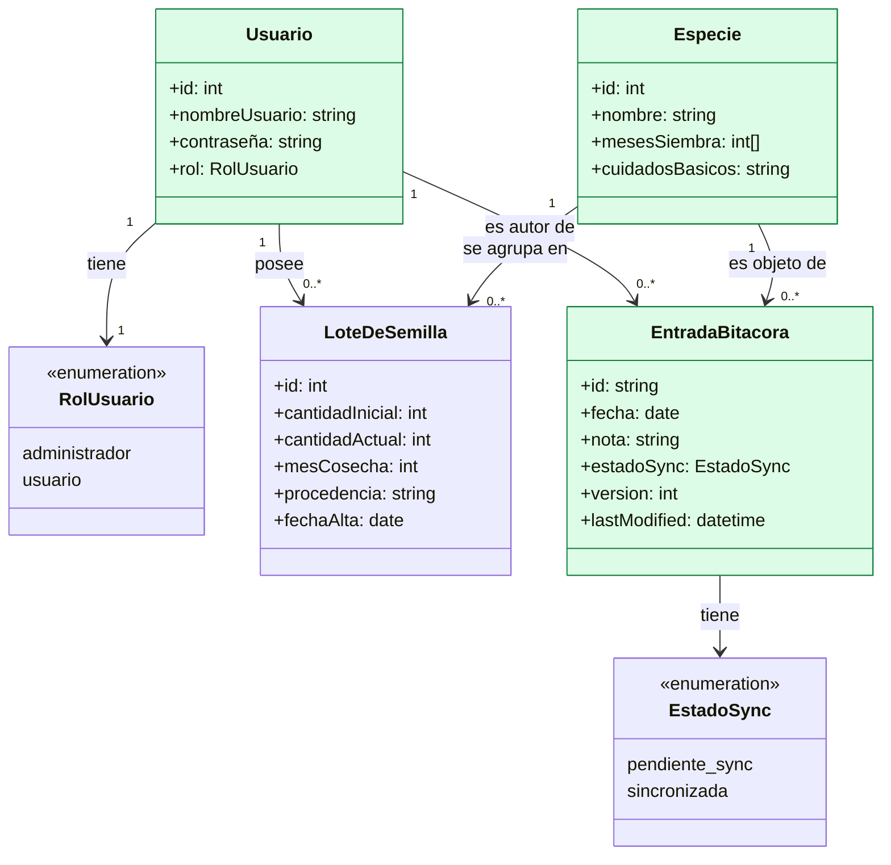
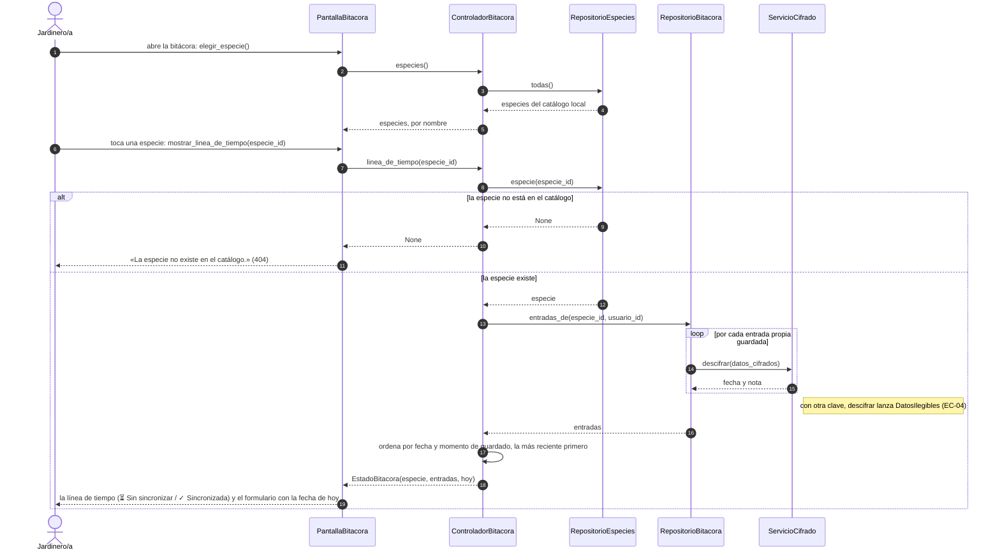
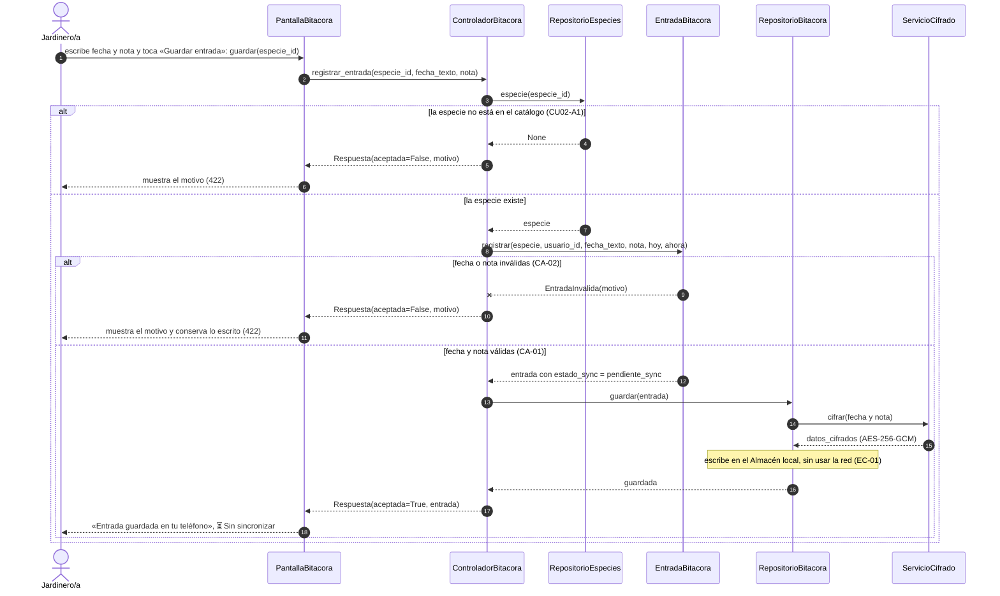
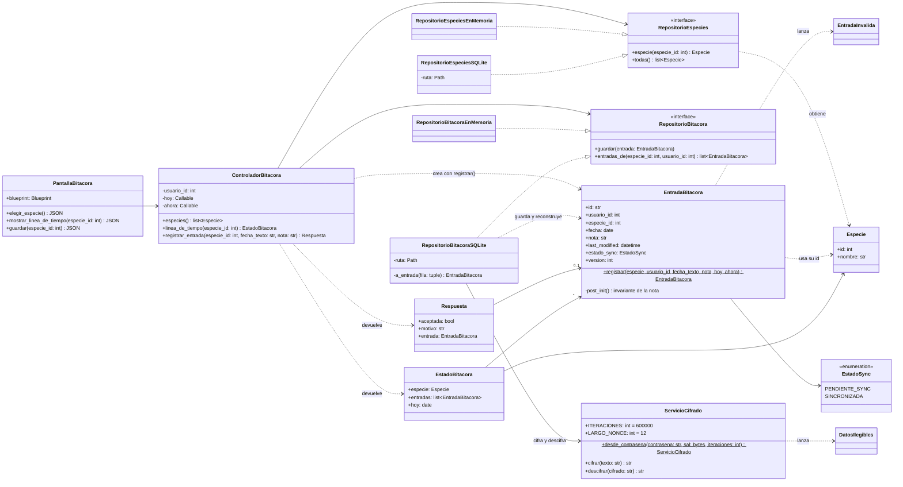
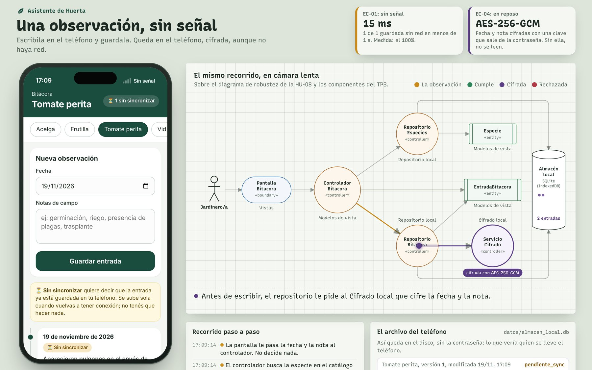
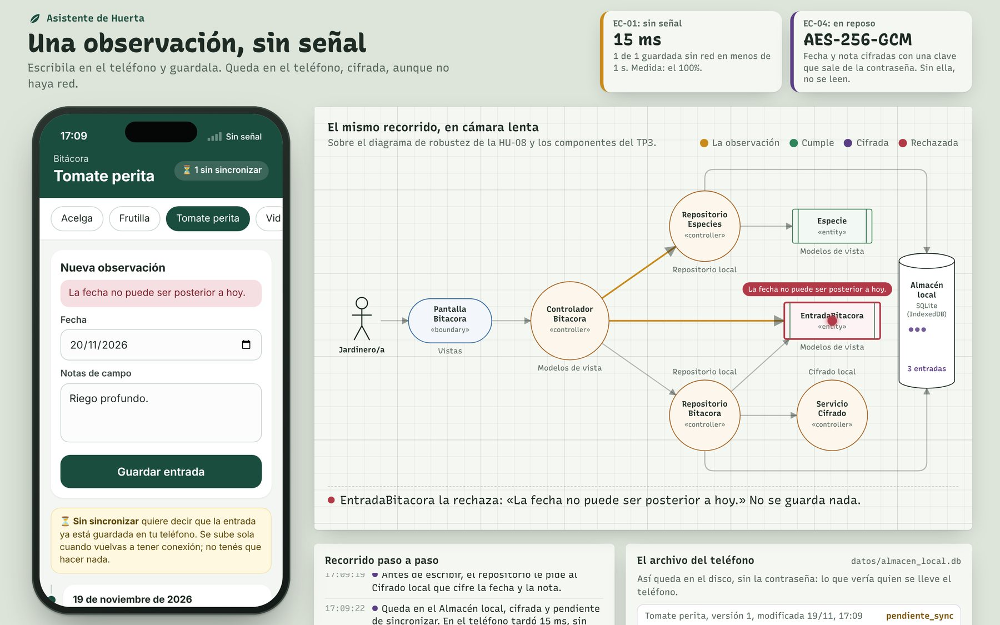
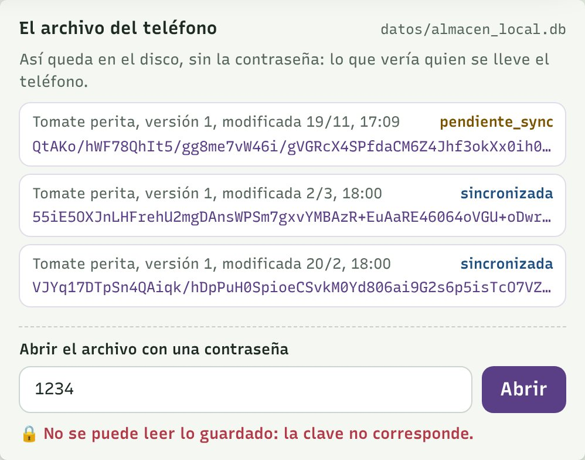
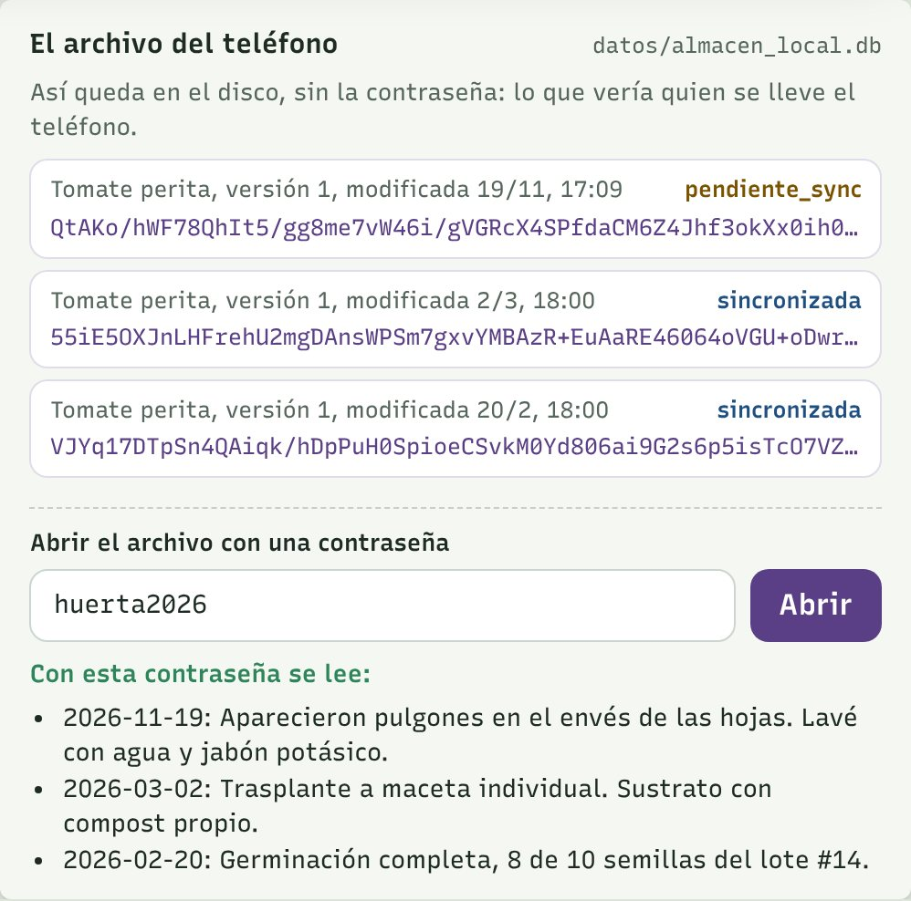

# Diseño detallado

**HU-08 — Registrar una observación en la bitácora.** TP4 de Ingeniería del Software 2026: diseño detallado, implementación y pruebas unitarias.

El código está en [`src/`](../../src), las pruebas en [`tests/`](../../tests), las instrucciones para instalar y ejecutar en el [`README.md`](../../README.md) y el registro de uso de IA en [`docs/uso-ia.md`](../uso-ia.md). El reporte de cobertura y su análisis van en la sección 7.4 de este documento.

---

## 1. Introducción

### 1.1 Propósito

Este documento baja la arquitectura del TP3 al diseño de una historia de usuario y la lleva hasta el código y las pruebas. Reúne la ficha y el análisis de la HU, el diagrama de robustez, los diagramas de secuencia, el modelo de clases obtenido del código, la justificación del diseño, la implementación, las pruebas y la trazabilidad, con las secciones del Anexo de la consigna.

### 1.2 HU elegida y motivo de la elección

Se elige la *HU-08: Registrar una observación en la bitácora*, acotada a su flujo de captura offline, validación de reglas de negocio y visualización en la línea de tiempo local.

La bitácora de campo es la herramienta diaria del jardinero para registrar las observaciones de cultivo en la huerta sin depender de la conectividad. Además, se cumple con las tres condiciones exigidas: asociación directa a escenarios de calidad (EC-01: disponibilidad offline, y EC-04: seguridad en reposo), atraviesa los componentes internos del contenedor *Aplicación móvil* (Vistas de stock y bitácora, Modelos de vista, Repositorio local y Cifrado local) y está respaldada por la decisión de arquitectura DA-01: Local-First con patrón Repository.

**Qué tiene de relevante para el proyecto.** La bitácora es la razón de ser de la aplicación: el TP2 la describe como «años de observaciones personales» (escenario 4.1) y dice que la conectividad intermitente en el campo es «la condición de uso normal del usuario, no una excepción rara» (escenario 3.1). Si guardar una observación falla sin señal, la aplicación no sirve en el lugar donde más se la necesita; si lo guardado se puede leer en un teléfono perdido, se expone justo lo que más le importa a la persona. Es además la HU donde se encuentran, en una sola operación, las dos tácticas del TP3 que definen al cliente: operar sin red y cifrar en reposo.

**Alcance de este TP (el *slice*).**

| Entra | Queda afuera |
|---|---|
| Elegir la especie del catálogo local y ver su línea de tiempo | La sincronización con el servidor (Gestor de sincronización, API, Cola y Procesador del TP3): las entradas quedan pendientes |
| Cargar fecha y nota, validarlas y rechazar con su motivo | El inicio de sesión real (CU00): se simula la sesión de la cuenta precargada «usuario» |
| Guardar en el teléfono, cifrado y pendiente de sincronizar | Ofrecer el alta de una especie que no está (HU-06, flujo A1 de CU02): acá se rechaza |
| Ver la entrada nueva en la línea de tiempo | Editar o eliminar entradas (HU-09) |

### 1.3 Siglas

| Sigla | Significado |
|---|---|
| AES | *Advanced Encryption Standard*: algoritmo de cifrado simétrico |
| API | Interfaz de programación de aplicaciones |
| C4 | Contexto, Contenedor, Componente, Código: modelo de documentación de arquitectura |
| CA | Criterio de aceptación |
| CP | Caso de prueba |
| CU | Caso de uso |
| DA | Decisión de arquitectura |
| EC | Escenario de calidad |
| GCM | *Galois/Counter Mode*: modo de AES que además detecta si el dato cifrado fue modificado |
| GRASP | *General Responsibility Assignment Software Patterns*: patrones para asignar responsabilidades |
| HU | Historia de usuario |
| IA | Inteligencia artificial |
| MVVM | *Model-View-ViewModel*: modelo, vista y modelo de vista |
| PBKDF2 | *Password-Based Key Derivation Function 2*: función que deriva una clave a partir de una contraseña |
| PWA | *Progressive Web App*: aplicación web instalable que funciona sin conexión |
| RF | Requerimiento funcional |
| TP | Trabajo práctico |
| UML | Lenguaje unificado de modelado |
| UUID | *Universally Unique Identifier*: identificador que se genera sin coordinarse con un servidor |

---

## 2. Relación con la arquitectura

### 2.1 Tabla de coherencia

| Dimensión | Contenido |
|---|---|
| Funcionalidad | HU-08 Registrar observación en bitácora (CU02 / RF05; la línea de tiempo es RF10). Camino principal de alta offline con actualización de la línea de tiempo, y caminos de rechazo por datos inválidos (CU02-E1) o especie inexistente (CU02-A1). |
| Estructura | Contenedor: Aplicación móvil (PWA). Estilo: Local-First, cliente-servidor desacoplado con almacén local (DA-01). Patrones: MVVM + Repository local. Componentes que atraviesa: Vistas de stock y bitácora (Presentación), Modelos de vista de stock y bitácora (Control / Aplicación, **principal**), Repositorio local (Acceso a datos) y Cifrado local (Transversal). Llega al contenedor Almacén local (IndexedDB). |
| Calidad | **EC-01** (Fiabilidad, disponibilidad; escenario 3.1 del TP2): el 100% de los registros iniciados sin red se almacenan exitosamente en el dispositivo en menos de 1 s y quedan visibles como pendientes de sincronizar. Táctica: degradación controlada, operar offline (DA-01). **EC-04** (Seguridad, confidencialidad; escenario 4.1): protección de los datos personales en el dispositivo. Táctica: cifrar los datos en reposo (AES), con una clave que sale de la contraseña. En la trazabilidad del TP3, EC-04 está respaldado por DA-01 / DA-03. |
| Dominio | Entidades del modelo del TP1 que intervienen: Usuario, Especie y EntradaBitacora (ver 3.2). |
| Verificación | Pruebas unitarias en pytest simulando ausencia total de red: se verifica que el guardado local se complete en menos de 1 s, marque la entrada como `pendiente_sync`, la cifre al persistir y la exponga ordenada en la línea de tiempo de la especie (CP-25 a CP-29). |

**De dónde sale el «menos de 1 s».** La medida del escenario 3.1 del TP2 es el 100% de las cargas, visibles como pendientes. El límite de tiempo lo agrega la ficha y sale del TP3, que en el recorrido de una carga sin conexión pide que la interfaz confirme el guardado en menos de 1 segundo. Se verifican las dos cosas (CP-26).

### 2.2 Componentes y capas que atraviesa

| Componente o contenedor del TP3 | Capa | Qué hace en la HU | Elementos del diseño |
|---|---|---|---|
| Vistas de stock y bitácora | Presentación | Muestra el formulario y la línea de tiempo, y manda lo que escribe la persona | `PantallaBitacora` |
| Modelos de vista de stock y bitácora (**principal**) | Control / Aplicación, con su modelo de dominio | Coordina el registro y arma la línea de tiempo. Las reglas de una entrada viven en las entidades | `ControladorBitacora`; `EntradaBitacora` y `Especie` |
| Repositorio local | Acceso a datos | Lee el catálogo, guarda y lee las entradas, y marca lo pendiente | `RepositorioEspecies`, `RepositorioBitacora` |
| Cifrado local | Transversal | Cifra antes de guardar y descifra al leer | `ServicioCifrado` |
| Almacén local (contenedor) | Datos | Guarda el catálogo y las entradas en el teléfono | IndexedDB en la PWA; un archivo SQLite en el prototipo |

### 2.3 Estilo y patrones del TP3, y cómo los respeta el diseño

| Del TP3 | Cómo lo respeta el diseño |
|---|---|
| Local-First (DA-01): las lecturas y escrituras ocurren sobre el almacén local | El controlador no conoce la red: guarda siempre a través del Repositorio local. No hay un «modo sin conexión» con condiciones: con señal o sin ella, el camino es el mismo. Las pruebas corren con la red cortada (CP-25). |
| MVVM | La pantalla (vista) solo muestra y manda acciones. El controlador hace de modelo de vista: arma el estado de la línea de tiempo (`EstadoBitacora`) y la respuesta al guardar (`Respuesta`). El modelo son las entidades `EntradaBitacora` y `Especie`. |
| Repository | El controlador depende de dos interfaces, `RepositorioEspecies` y `RepositorioBitacora`, con dos implementaciones cada una: en memoria y en SQLite cifrado. |
| Cifrado en reposo como aspecto transversal | El cifrado lo pide el repositorio, no el controlador ni el dominio: ninguna regla de la HU sabe que lo guardado va cifrado. |
| Escrituras marcadas `pendiente_sync` | Toda entrada nace `pendiente_sync` (valor inicial en la entidad). Pasarla a `sincronizada` es del Gestor de sincronización, fuera de esta HU. |
| Dependencias en un solo sentido | Interfaz → aplicación → dominio. La infraestructura implementa las interfaces de la aplicación. El dominio no importa nada de las otras capas. |

### 2.4 Cambios a la arquitectura del TP3 y al modelo de dominio del TP1

Al bajar al diseño aparecieron tres diferencias. Se documentan acá y se actualizaron los documentos anteriores:

| Dónde | Qué decía | Qué se cambió y por qué |
|---|---|---|
| Catálogo de relaciones de la Aplicación móvil (`docs/architecture/arquitectura.md`) | Modelos de vista → Repositorio local: «Lectura y guardado de lotes y notas» | Se agregó «y lectura del catálogo de especies», también en la etiqueta del diagrama de componentes. La HU le pide al Repositorio local la especie elegida (CU02, paso 3) y ese mensaje no estaba en el catálogo. |
| Catálogo de componentes de la Aplicación móvil | Modelos de vista: «Validar lotes y notas…» | Se aclaró que las reglas de lotes y notas viven en las entidades del dominio, dentro de este mismo componente (el modelo de MVVM), y que el modelo de vista coordina y arma el estado. No hizo falta un componente nuevo. |
| Modelo de dominio del TP1 (`docs/requirements/srs.md`) | `EntradaBitacora` con `id: int`, `fecha` y `nota` | Se agregaron `estadoSync` (enumeración `EstadoSync`), `version` y `lastModified`, y el `id` pasó a texto (UUID). Son los atributos de la tabla de entidades del grupo (3.2): sin ellos no se puede marcar lo pendiente (EC-01), y sin red no hay servidor que numere, así que el id se genera en el teléfono. |

En el código los atributos usan los nombres de la tabla de entidades del grupo, en minúsculas con guion bajo (`estado_sync`, `last_modified`); el SRS conserva su convención (`estadoSync`, `lastModified`).

---

## 3. Diseño de la HU

### 3.1 Enunciado y criterios de aceptación (TP1)

**HU-08 (obligatoria) — Registrar una observación en la bitácora** (Realiza: RF05, CU02)

Como usuario autenticado, quiero agregar una nota de observación de campo para una especie, para llevar un historial de la evolución de mi cultivo.

Criterios de aceptación (TP1):

- **CA-01 (Éxito):** Given que tengo una especie seleccionada, When cargo una nueva entrada con fecha y notas y la guardo, Then aparece en la línea de tiempo de esa especie.
- **CA-02 (Rechazo):** Given que ingreso datos en un formato inválido, When intento guardar, Then el sistema muestra un error y no guarda la entrada.

**Qué es un «formato inválido».** CA-02 no lo detalla. Se precisa con las decisiones del TP2 sobre el formulario (evaluación heurística de `pantalla-hu08-hu09-formulario-entrada`): la fecha viene sugerida en el día de hoy y se valida su rango (decisión 1), y la nota es texto libre, sin límite de largo (decisión 5).

| Dato | Válido | Inválido, con el motivo que se muestra |
|---|---|---|
| Fecha | Una fecha que existe en el calendario, hasta hoy inclusive | Vacía, con otro formato o inexistente: «Ingresá una fecha válida.» Posterior a hoy: «La fecha no puede ser posterior a hoy.» |
| Nota | Al menos un carácter que no sea espacio, sin límite de largo. Se guarda sin los espacios de los bordes | Vacía o solo con espacios: «Escribí la nota de la observación.» |
| Especie | Una del catálogo local | Una que no está (CU02-A1): «La especie no existe en el catálogo.» |

### 3.2 Entidades del modelo de dominio

| Entidad de modelo | Interviene | Qué usa la HU | La HU la... | Motivo |
|---|---|---|---|---|
| EntradaBitacora | Sí | id, usuario_id, especie_id, fecha, nota, estado_sync, version, last_modified | Crea y consulta | Entidad principal: valida las reglas de negocio de fecha y nota, y conforma los ítems de la línea de tiempo de la especie. |
| Especie | Sí | id, nombre | Consulta | Verifica que la especie seleccionada exista en el catálogo local antes de asociarle la observación. |
| Usuario | Sí | id | Consulta | Identifica al autor autenticado de la observación para filtrar su línea de tiempo privada. |
| LoteDeSemilla | No | — | — | Pertenece al módulo de inventario de semillas (CU01), sin intervención en el registro de observaciones de campo. |
| RolUsuario | No | — | — | Enumeración descriptiva (admin / usuario) que no altera la lógica de carga de notas en la bitácora. |

**Usuario interviene, pero no se dibuja en la robustez.** La HU no carga ni modifica un `Usuario`: usa solo su id, que llega con la sesión (CU00) y que el controlador recibe al crearse. Con ese id se firma la entrada (`usuario_id`) y se filtra la línea de tiempo, para que cada persona vea solo lo suyo (RF05).

En verde, las entidades del modelo del TP1 que intervienen, con el cambio de 2.4 ya aplicado:



### 3.3 Análisis tridimensional

| Dimensión | Elemento | Detalle |
|---|---|---|
| Funcionalidad | CA-01 | Con una especie elegida, cargar fecha y nota y guardar: la entrada queda en el teléfono y aparece primera en la línea de tiempo de esa especie. |
| Funcionalidad | CA-02 | Con una fecha que no se puede leer, una fecha posterior a hoy o una nota vacía, rechazar, mostrar el motivo y no guardar nada. |
| Funcionalidad | CU02-A1 | Si la especie no está en el catálogo, rechazar con su motivo (ofrecer el alta es la HU-06, fuera de este alcance). |
| Estructura | Frontera | `PantallaBitacora`. |
| Estructura | Control | `ControladorBitacora`, que coordina, y tres controladores técnicos: `RepositorioEspecies`, `RepositorioBitacora` y `ServicioCifrado`. |
| Estructura | Dominio | `EntradaBitacora` (sabe si una fecha y una nota son válidas y nace pendiente de sincronizar) y `Especie` (dice a qué cultivo corresponde la observación). |
| Calidad | EC-01 | Sin red, el 100% de las cargas se guarda en el teléfono en menos de 1 s y queda visible como pendiente. **Condiciona:** el controlador no conoce la red; el repositorio escribe en el Almacén local; la entrada nace `pendiente_sync`; el id es un UUID generado en el teléfono. |
| Calidad | EC-04 | Sin la contraseña, lo guardado en el teléfono no se puede leer. **Condiciona:** el repositorio cifra la fecha y la nota antes de escribir y las descifra al leer; la clave sale de la contraseña y no se guarda en ningún lado. |

### 3.4 Diagrama de robustez

Leyenda: borde punteado = actor; rectángulo redondeado azul = «boundary»; círculo naranja = «controller»; rectángulo con barras verde = «entity». Cada flecha dice qué le pide un elemento a otro.


**Cómo leer el diagrama.**

| Relación | Qué representa | Por qué está |
|---|---|---|
| Jardinero → PantallaBitacora | El actor usa la frontera | El actor solo habla con la pantalla |
| PantallaBitacora → ControladorBitacora | La pantalla delega el registro y la consulta | La pantalla no decide ni toca el dominio |
| ControladorBitacora → RepositorioEspecies → Especie | El controlador **pide** la especie elegida | Antes de crear la entrada hay que saber que la especie existe |
| ControladorBitacora → EntradaBitacora | El controlador le pide a la entidad que se cree; la entidad **aplica sus reglas** de fecha y nota | Las reglas viven en la entidad, no en el controlador |
| ControladorBitacora → RepositorioBitacora | El controlador **guarda** la entrada y **pide** las de la especie | Guardar y leer es un trabajo técnico, sin reglas |
| RepositorioBitacora → ServicioCifrado | El repositorio **cifra** antes de escribir y **descifra** al leer | El cifrado en reposo es transversal: solo lo conoce quien guarda |
| RepositorioBitacora → EntradaBitacora | El repositorio **guarda** entradas y las **reconstruye** al leer | Es quien sabe dónde están las entradas |

Las dos entidades salen de la tabla de 3.2. Se cumplen las reglas de conexión de la Referencia: el actor solo toca la pantalla; la pantalla solo toca al controlador; las entidades se alcanzan desde controladores; los controladores se coordinan entre sí. El Almacén local no se dibuja: es donde escriben los repositorios, no un elemento de la HU, como la base de datos en el ejemplo de la consigna.

**Dónde vive cada regla de negocio.**

| Regla | Dónde vive | Por qué |
|---|---|---|
| R1. La fecha tiene que existir en el calendario (llega como AAAA-MM-DD) | `EntradaBitacora.registrar` | Experto en información: la entrada es dueña de su fecha. La pantalla ayuda con el selector de fecha, pero cualquier camino que cree una entrada pasa por la regla |
| R2. La fecha no puede ser posterior a hoy | `EntradaBitacora.registrar` (el día de hoy lo pasa el controlador) | Ídem. La pantalla ayuda con el máximo del selector (`max` = hoy); el dominio garantiza |
| R3. La nota no puede estar vacía ni tener solo espacios, y no tiene límite de largo | Invariante de `EntradaBitacora` (`__post_init__`) | No se puede saltear: ni construyendo la entidad a mano (CP-08) ni al reconstruirla desde el almacén |
| R4. La entrada es de una especie del catálogo | `ControladorBitacora`, que le pide la especie a `RepositorioEspecies` | No es una regla de la entrada sino la falta de otro objeto: el controlador no decide nada sobre la especie, informa que no la encontró (CU02-A1). La entidad recibe una `Especie`, no un id suelto |
| R5. Toda entrada nueva nace pendiente de sincronizar (EC-01) | `EntradaBitacora` (valor inicial de `estado_sync`) | Experto: es un dato de la entrada |
| R6. Cada persona ve solo sus entradas (RF05) | `RepositorioBitacora.entradas_de(especie_id, usuario_id)`, con el usuario de la sesión que pasa el controlador | Filtrar lo guardado es acceso a datos |
| R7. La línea de tiempo va de la más reciente a la más vieja; con la misma fecha, primero la guardada después (RF10) | `ControladorBitacora.linea_de_tiempo` | Preparar lo que muestra la vista es tarea del modelo de vista (MVVM); no es una regla de una entrada sola |
| R8. Lo que se guarda en el teléfono va cifrado (EC-04) | `RepositorioBitacoraSQLite`, con `ServicioCifrado` | Aspecto transversal: el dominio no sabe nada del cifrado |

**Cada elemento, en su componente y su capa.**

| Elemento | Tipo | Componente del TP3 | Capa | Código |
|---|---|---|---|---|
| Jardinero / Usuario | Actor | — | — | — |
| PantallaBitacora | Boundary | Vistas de stock y bitácora | Presentación | `src/interfaz/pantalla_bitacora.py` y la página `src/demo/static/` |
| ControladorBitacora | Controller | Modelos de vista de stock y bitácora | Control / Aplicación | `src/aplicacion/controlador_bitacora.py` |
| EntradaBitacora | Entity | Modelos de vista de stock y bitácora | Dominio (el modelo de MVVM) | `src/dominio/entrada_bitacora.py` |
| Especie | Entity | Modelos de vista de stock y bitácora | Dominio | `src/dominio/especie.py` |
| RepositorioEspecies | Controller (técnico) | Repositorio local | Acceso a datos | Interfaz en `src/aplicacion/puertos.py`; implementaciones en `src/infraestructura/` |
| RepositorioBitacora | Controller (técnico) | Repositorio local | Acceso a datos | Ídem |
| ServicioCifrado | Controller (técnico) | Cifrado local | Transversal | `src/infraestructura/servicio_cifrado.py` |

### 3.5 Diagramas de secuencia

Se dibujan dos secuencias con los participantes de la robustez: la **A**, elegir la especie y ver su línea de tiempo; y la **B**, registrar una observación, con los dos rechazos en fragmentos `alt`. CA-01 termina en la A: después de guardar, la pantalla vuelve a pedir la línea de tiempo y la entrada aparece primera.

**Secuencia A: elegir la especie y ver su línea de tiempo**



**Cómo se lee la secuencia A.**

1. Al abrir la bitácora, la pantalla pide las especies al controlador y este al `RepositorioEspecies`. La persona elige una (CU02, pasos 2 y 3).
2. La pantalla pide la línea de tiempo. El controlador busca la especie; si no está, responde `None` y la pantalla muestra el motivo.
3. Si está, el controlador le pide al `RepositorioBitacora` las entradas de esa especie **y de esa persona** (RF05). El repositorio las lee del Almacén local y le pide al `ServicioCifrado` que descifre cada una. Si la clave no corresponde, `descifrar` lanza `DatosIlegibles`: eso es EC-04.
4. El controlador ordena las entradas y devuelve el estado de la vista, con la fecha de hoy para sugerirla en el formulario (decisión 1 del TP2). La pantalla lo muestra, con la píldora del estado de sincronización de cada entrada.

**Secuencia B: registrar una observación (éxito y rechazos)**



**Cómo se lee la secuencia B.**

1. La pantalla no valida nada: le pasa al controlador la especie elegida, la fecha como la mandó el selector y la nota.
2. El controlador busca la especie. Si no está en el catálogo (CU02-A1), responde un rechazo con el motivo y no se crea nada.
3. Con la especie en la mano, el controlador le pide a `EntradaBitacora` que se cree con `registrar(...)`, y le pasa el usuario de la sesión, el día de hoy y el momento actual. La entidad aplica las reglas R1 a R3: si algo no se cumple, lanza `EntradaInvalida` con el motivo, el controlador lo convierte en una `Respuesta` rechazada y la pantalla lo muestra sin borrar lo escrito (CA-02). No se guardó nada.
4. Si las reglas se cumplen, la entrada nace `pendiente_sync` (R5) y el controlador se la da al `RepositorioBitacora`. **Las dos tácticas se ven acá:** el repositorio le pide al `ServicioCifrado` que cifre la fecha y la nota (EC-04) y escribe en el Almacén local, sin ningún mensaje hacia la red (EC-01).
5. El controlador responde `aceptada` y la pantalla avisa que quedó guardada en el teléfono, sin sincronizar. Después vuelve a pedir la línea de tiempo (secuencia A) y la entrada aparece primera: eso cierra CA-01.

Las dos decisiones (la especie y las reglas de la entrada) ocurren antes de guardar, así que un rechazo no deja nada a medias.

**Cada mensaje entre componentes está en el catálogo del TP3.**

| Mensajes | De → a | Componentes | Relación del catálogo del TP3 |
|---|---|---|---|
| `elegir_especie()`, `mostrar_linea_de_tiempo()`, `guardar()` | Jardinero/a → PantallaBitacora | Persona → Vistas | Uso de la interfaz |
| `especies()`, `linea_de_tiempo()`, `registrar_entrada()` | PantallaBitacora → ControladorBitacora | Vistas → Modelos de vista | Enlace de datos y acciones del usuario |
| `registrar(...)` | ControladorBitacora → EntradaBitacora | Dentro de Modelos de vista | No hace falta: mismo componente |
| `todas()`, `especie(especie_id)` | ControladorBitacora → RepositorioEspecies | Modelos de vista → Repositorio local | Lectura y guardado de lotes y notas, **y lectura del catálogo de especies** (agregado, ver 2.4) |
| `guardar(entrada)`, `entradas_de(especie_id, usuario_id)` | ControladorBitacora → RepositorioBitacora | Modelos de vista → Repositorio local | Lectura y guardado de lotes y notas |
| `cifrar(...)`, `descifrar(...)` | RepositorioBitacora → ServicioCifrado | Repositorio local → Cifrado local | Cifrado y descifrado de datos sensibles |
| Escribe y lee (la nota de la secuencia B) | Repositorios → Almacén local | Repositorio local → Almacén local | Lectura y escritura (IndexedDB API; en el prototipo, SQLite) |

**Asignación de responsabilidades.**

| Responsabilidad | Quién | Criterio GRASP |
|---|---|---|
| Decidir si la fecha y la nota son válidas | `EntradaBitacora` (`registrar` y su invariante) | Experto en información: la entrada conoce su fecha y su nota |
| Crear la entrada | `ControladorBitacora`, con el constructor con nombre `EntradaBitacora.registrar` | Creador: el controlador tiene los datos para iniciarla (la especie elegida, el usuario de la sesión y el reloj); la construcción con reglas la hace la entidad |
| Nacer pendiente de sincronizar, con versión 1 y su momento de modificación | `EntradaBitacora` | Experto en información |
| Coordinar el registro y la consulta | `ControladorBitacora` | Controlador: recibe el evento de la pantalla y coordina, sin hacer el trabajo del dominio |
| Ordenar la línea de tiempo y exponer la fecha de hoy | `ControladorBitacora` | Alta cohesión: preparar el estado de la vista es lo que hace un modelo de vista |
| Buscar la especie; guardar y leer entradas; filtrar por persona | `RepositorioEspecies`, `RepositorioBitacora` | Alta cohesión y bajo acoplamiento: el controlador no sabe dónde ni cómo se guarda |
| Cifrar y descifrar | `ServicioCifrado`, a pedido del repositorio | Alta cohesión: hace una sola cosa. Bajo acoplamiento: ni el dominio ni el controlador saben del cifrado |
| Traducir los pedidos y mostrar las respuestas | `PantallaBitacora` | Bajo acoplamiento: conoce solo al controlador |

---

## 4. Modelo de clases

### 4.1 Cómo se obtuvo

Después de implementar, el diagrama se generó desde el código con `pyreverse` (viene con `pylint`):

```bash
cd src
pyreverse -o mmd -f ALL -p HU08 dominio aplicacion infraestructura interfaz
```

La salida, sin tocar, está en [`clases-pyreverse.mmd`](clases-pyreverse.mmd). Para el diagrama de 4.2 se revisó contra el código y se limpió:

- Se quitaron los `__init__` y los atributos privados que solo guardan colaboradores que ya se dibujan como relaciones.
- Los repositorios se dibujan como `<<interface>>` y sus implementaciones como realización (`..|>`). pyreverse los muestra como herencia común (`--|>`), porque en Python las interfaces son clases abstractas (`ABC`).
- Se agregaron las dependencias de uso que pyreverse no detecta porque ocurren dentro de los métodos: el controlador crea `EntradaBitacora`, el repositorio SQLite la reconstruye y las operaciones lanzan sus excepciones.
- Quedaron afuera el punto de arranque (`main.py`) y el panel de la demostración (`src/demo/`), que no son clases de la HU.

### 4.2 Diagrama



Notas de notación: `$` marca los métodos de clase (`registrar`, `desde_contrasena`); los tipos `X | None` del código se escriben `X` (devuelven `None` cuando no encuentran); `post_init` es el `__post_init__` de la clase de datos de Python, donde vive la invariante de la nota.

### 4.3 Validación contra la robustez y las secuencias

| Diferencia encontrada | Qué estaba mal | Qué se hizo |
|---|---|---|
| pyreverse dibuja las implementaciones de los repositorios como herencia de una clase común | La notación: son interfaces, escritas como clases abstractas de Python | Se dibujan `<<interface>>` con realización (`..|>`). El código no cambia |
| pyreverse no muestra que el controlador crea la entrada ni que el repositorio SQLite la reconstruye | La herramienta solo ve atributos, no lo que pasa dentro de los métodos | Se agregaron esas dependencias, tomadas de las secuencias A y B |
| La robustez tiene un `RepositorioEspecies` y un `RepositorioBitacora`; el código tiene dos de cada uno | Nada: es la regla de la Referencia para los repositorios | El diagrama muestra cada interfaz con sus dos implementaciones (memoria y SQLite). Las secuencias hablan con la interfaz |
| `ServicioCifrado.desde_contrasena()` no aparece en ninguna secuencia | Nada: se usa al armar el programa, cuando empieza la sesión (CU00 simulado), antes de la HU | Se deja. Las secuencias arrancan con el servicio ya armado con la clave de la sesión |
| `Respuesta` y `EstadoBitacora` no están en la robustez | Nada: son las clases auxiliares que piden las secuencias, lo que devuelve el controlador | Se dejan, como la `Respuesta` del ejemplo de la consigna |
| `Especie`, `EstadoSync`, `EntradaInvalida` y `DatosIlegibles` no reciben mensajes | Nada: viajan como valores en las secuencias (`especie`, `estado_sync = pendiente_sync`, `EntradaInvalida(motivo)`, la nota sobre `DatosIlegibles` en A) | Se dejan |

Con eso, el diagrama coincide con el código y con las secuencias: cada participante es una clase, cada mensaje es una operación con el mismo nombre, y toda clase del diagrama aparece en alguna secuencia. Las reglas viven donde las ubicó la robustez (R1 a R3 en `EntradaBitacora`), así que las entidades no son anémicas.

---

## 5. Justificación del diseño

### 5.1 Responsabilidades de las clases principales

| Clase | Responsabilidad | Criterio GRASP |
|---|---|---|
| `EntradaBitacora` | Crearse solo si la fecha y la nota son válidas; no existir nunca sin nota; nacer pendiente de sincronizar | Experto en información |
| `Especie` | Identificar el cultivo al que se asocia la observación | Experto en información (lo que la HU necesita de ella es su id) |
| `ControladorBitacora` | Coordinar el registro y la consulta; crear la entrada; armar el estado de la vista | Controlador y Creador; alta cohesión |
| `RepositorioEspecies`, `RepositorioBitacora` (interfaces) | Ocultar dónde y cómo se guarda | Bajo acoplamiento (variaciones protegidas) |
| `RepositorioBitacoraSQLite` | Guardar y leer entradas en el Almacén local, cifradas | Alta cohesión |
| `ServicioCifrado` | Cifrar y descifrar con una clave que sale de la contraseña | Alta cohesión; fabricación pura (no es un concepto del dominio) |
| `PantallaBitacora` | Traducir los pedidos de la página y mostrar las respuestas, incluidos los rechazos | Bajo acoplamiento |

### 5.2 Decisiones de diseño

1. **Las reglas de fecha y nota viven en la entidad.** Es la opción C de la Referencia: la entidad tiene la información, la regla no se puede saltear y no pueden existir entradas inválidas. La de la nota es una invariante (`__post_init__`): se cumple aunque alguien construya la entidad a mano (CP-08) o la reconstruya desde el almacén. La pantalla ayuda (sugiere la fecha de hoy y no deja elegir una fecha futura en el selector), pero el dominio garantiza.
2. **El reloj se recibe, no se consulta.** `EntradaBitacora.registrar` recibe `hoy` y `ahora`; el controlador y `crear_app` reciben funciones que los dan. En las pruebas el reloj es fijo (15/03/2026), y el borde «hoy / mañana» se prueba sin depender del día en que se corra.
3. **Interfaces para los repositorios, y no para el cifrado.** Los repositorios tienen dos implementaciones reales (memoria y SQLite) y la defensa pide cambiar una por otra sin tocar el controlador: la interfaz vale su costo. `ServicioCifrado` tiene una sola implementación: el repositorio en memoria no cifra porque no deja nada guardado en el teléfono. Una interfaz ahí sería indirección sin una segunda implementación.
4. **La clave sale de la contraseña y no se guarda.** PBKDF2-HMAC-SHA256 con 600.000 iteraciones (lo que recomienda OWASP) y una sal de 16 bytes guardada en el teléfono. Es lo que pide la medida del escenario 4.1: «sin las credenciales del usuario, el 100% de los datos personales es inaccesible». Si la clave estuviera guardada junto a los datos, quien tuviera el teléfono la tendría también.
5. **AES-256-GCM.** Es el cifrado que ofrece la Web Crypto API que nombra el TP3, y además autentica: si alguien modifica lo guardado, no se descifra (CP-20). Cada cifrado usa un nonce nuevo (CP-18).
6. **Qué se cifra.** La fecha y la nota, que son los datos personales de la observación. Quedan en claro los ids, el estado de sincronización, la versión y la fecha de modificación: el repositorio los necesita para filtrar y el Gestor de sincronización para saber qué enviar, sin descifrar todo. El costo, asumido: quien tenga el teléfono puede ver cuántas entradas hay y cuándo se modificaron, pero no qué dicen.
7. **El id es un UUID generado en el teléfono.** Sin red no hay servidor que numere, y un UUID no choca cuando se sincronicen entradas creadas sin conexión en distintos dispositivos.
8. **El controlador no conoce la red.** Guardar en el teléfono es el único camino, con o sin señal (Local-First). No hay un «modo sin conexión» que agregue condiciones al controlador.
9. **Un repositorio por entidad**, como en la robustez: `RepositorioEspecies` solo busca especies y `RepositorioBitacora` solo guarda y lee entradas.

### 5.3 Patrones de diseño usados

| Patrón | Problema que resuelve | Dónde está en el diagrama |
|---|---|---|
| Repository (viene del TP3, DA-01) | Que el controlador no dependa de cómo ni dónde se guarda, y se pueda cambiar la persistencia sin tocarlo | `RepositorioEspecies` y `RepositorioBitacora` (`<<interface>>`), con sus implementaciones en memoria y SQLite |

No se usaron otros patrones de diseño. `EntradaBitacora.registrar` es un constructor con nombre (un método de clase que valida y crea), no el patrón Factory. Que el controlador reciba sus colaboradores por el constructor (inyección de dependencias) es una regla de implementación de la Referencia: los objetos concretos se arman en un único lugar, `src/main.py`.

---

## 6. Implementación

### 6.1 Estructura del código

```text
src/
├── dominio/                       # entidades, con sus reglas
│   ├── entrada_bitacora.py        # EntradaBitacora, EstadoSync, EntradaInvalida
│   └── especie.py                 # Especie
├── aplicacion/                    # el controlador y las interfaces
│   ├── controlador_bitacora.py    # ControladorBitacora, Respuesta, EstadoBitacora
│   └── puertos.py                 # RepositorioEspecies, RepositorioBitacora
├── infraestructura/               # lo que implementa las interfaces
│   ├── repositorios_en_memoria.py
│   ├── repositorios_sqlite.py     # el Almacén local en un archivo SQLite, cifrado
│   └── servicio_cifrado.py        # ServicioCifrado (Cifrado local), DatosIlegibles
├── interfaz/
│   └── pantalla_bitacora.py       # PantallaBitacora (boundary), con Flask
├── demo/                          # la página de la demostración (no es parte de la HU)
│   ├── panel.py, inspector.py     # sirven la página y muestran el archivo tal como quedó en disco
│   └── static/                    # index.html, estilo.css, app.js y la tipografía
└── main.py                        # punto de arranque: arma los objetos concretos
tests/                             # pytest, sin red y con el reloj fijo
```

Las dependencias van en un solo sentido: `interfaz` → `aplicacion` → `dominio`, e `infraestructura` implementa las interfaces de `aplicacion`. El dominio no importa nada de las otras carpetas.

### 6.2 Cómo se ejecuta

Los comandos completos, para una máquina limpia, están en el [`README.md`](../../README.md). En resumen:

```bash
pip install -r requirements.txt
python src/main.py          # abrir http://127.0.0.1:8000
python -m pytest            # las pruebas
```

`main.py` crea la carpeta `datos/` la primera vez, con el archivo del Almacén local (`almacen_local.db`) y la sal (`sal.bin`), y carga el catálogo y dos observaciones de ejemplo ya sincronizadas, las del maquetado del TP2. No hace falta crear la base a mano. `python src/main.py --limpio` borra `datos/` y empieza de cero.

### 6.3 Cómo se reemplazan la persistencia y los servicios externos

**La persistencia.** El controlador recibe sus dos repositorios por el constructor y solo conoce las interfaces. Para cambiar SQLite por la versión en memoria hay dos formas:

- Al ejecutar: `python src/main.py --memoria`. La aplicación funciona igual; el panel del archivo muestra que no queda nada en el disco.
- En el código, en `crear_app` de `src/main.py`, que es el único lugar que conoce las clases concretas:

```python
if en_memoria:
    especies, entradas = RepositorioEspeciesEnMemoria(CATALOGO), RepositorioBitacoraEnMemoria()
    archivo, sal, primera_vez = None, None, True
else:
    ...  # crea la carpeta y lee o crea la sal
    especies = RepositorioEspeciesSQLite(archivo, CATALOGO)
    entradas = RepositorioBitacoraSQLite(archivo, ServicioCifrado.desde_contrasena(CONTRASENA, sal))
...
controlador = ControladorBitacora(USUARIO, especies, entradas, hoy=hoy, ahora=ahora)
```

El controlador no cambia porque no sabe cuál le tocó: les habla a `RepositorioEspecies` y `RepositorioBitacora`. Las pruebas de contrato (CP-22 a CP-24) corren las mismas verificaciones sobre las dos implementaciones, y CP-35 arma el programa entero con la de memoria.

**Los servicios externos.** Este *slice* no usa ninguno: la HU funciona sin red, y la sincronización con el servidor queda afuera. Por eso no hay clases simuladas de servicios externos. Las pruebas cortan la red (CP-25) para comprobar que nada la usa.

### 6.4 Qué se simplificó respecto del TP3

| En el TP3 | En el prototipo | Por qué |
|---|---|---|
| PWA en React que corre en el teléfono | La página `src/demo/static/` hace de pantalla del teléfono y un programa en Python hace de su interior | La consigna pide implementar en el lenguaje del grupo; el diseño no depende de la tecnología |
| Las Vistas llaman al modelo de vista dentro de la misma aplicación | La página le habla a `PantallaBitacora` por HTTP, en `127.0.0.1` | Es una llamada dentro de la misma computadora: no sale a la red, y la demostración funciona con el Wi-Fi apagado |
| IndexedDB | Un archivo SQLite en `datos/` | Mismo papel: el Almacén local, en el dispositivo |
| Web Crypto API (AES) | La biblioteca `cryptography` (AES-256-GCM) y `hashlib` (PBKDF2) | Mismos algoritmos |
| Inicio de sesión (CU00) | Sesión simulada de la cuenta precargada «usuario» (id 2); la contraseña de la demostración es `huerta2026` | El inicio de sesión es otra HU |
| Gestor de sincronización | No se incluye: las entradas nuevas quedan `pendiente_sync` | Fuera del alcance de la HU |
| Catálogo de especies que llega por sincronización | Cuatro especies precargadas en el Almacén local | Ídem |

### 6.5 La demostración en vivo

La página muestra el teléfono a la izquierda y, a la derecha, el diagrama de robustez de la HU con los componentes del TP3, donde se repite en cámara lenta el recorrido de cada acción. Debajo están el recorrido paso a paso y el archivo del teléfono tal como quedó en el disco. **Nada se mueve solo:** cada recorrido empieza cuando alguien elige una especie o guarda una observación en el teléfono. Al diagrama se le agrega el Almacén local, para que se vea dónde termina el recorrido.

Guion sugerido para la defensa:

1. Antes de empezar, apagar el Wi-Fi de la computadora y ejecutar `python src/main.py --limpio`. La aplicación funciona igual: es el escenario EC-01.
2. **CA-01.** Con «Tomate perita» elegida, escribir una nota y tocar «Guardar entrada». En el teléfono, la entrada aparece primera, con «⏳ Sin sincronizar». En el diagrama se ven la búsqueda de la especie, las reglas en `EntradaBitacora`, el cifrado y el guardado en el Almacén local. La tarjeta EC-01 muestra cuánto tardó. El mismo recorrido está en la secuencia B (3.5) y en `ControladorBitacora.registrar_entrada` (`src/aplicacion/controlador_bitacora.py`).
3. **CA-02.** Escribir a mano, en el campo de la fecha, la de mañana (el calendario no deja elegirla: la pantalla ayuda, el dominio garantiza) y guardar. Después, probar con la nota vacía. El teléfono muestra el motivo y no borra lo escrito; en el diagrama, el recorrido se frena en `EntradaBitacora` y vuelve en rojo. No se agrega nada al archivo.
4. **EC-04.** En «El archivo del teléfono», mostrar que la fecha y la nota están cifradas. Probar «Abrir» con cualquier contraseña (no se puede leer) y después con `huerta2026` (se lee).
5. **Cambiar la implementación.** Cortar el programa, ejecutar `python src/main.py --memoria` y repetir el paso 2: funciona igual y el panel avisa que no hay archivo. Mostrar `crear_app` en `src/main.py` y el constructor de `ControladorBitacora`.



*Guardar sin señal (CA-01, EC-01): la entrada ya aparece en el teléfono, pendiente de sincronizar, y el recorrido pasa por el Cifrado local antes de llegar al Almacén local.*



*Rechazo (CA-02): la regla vive en `EntradaBitacora`; el teléfono muestra el motivo y conserva lo escrito.*

| Sin la contraseña | Con la contraseña de la cuenta |
|---|---|
|  |  |

*EC-04: en el disco, la fecha y la nota están cifradas; con otra contraseña no se pueden leer.*

---

## 7. Pruebas

Las pruebas están en `tests/` y se ejecutan con pytest. Todas corren **con la red cortada** (un *fixture* de `conftest.py` hace fallar cualquier intento de conexión) y **con el reloj fijo**: hoy es el 15/03/2026 y cada llamada al reloj avanza un minuto. Ninguna pasa por la interfaz gráfica: los criterios de aceptación se prueban sobre la entidad y el controlador; la frontera se prueba aparte (CP-30 a CP-32), con el cliente de pruebas de Flask y sin navegador, para verificar que traduce y no decide. Como dobles de prueba se usan los repositorios en memoria.

### 7.1 Casos de prueba

| ID | Técnica | Origen | Dado (entrada y estado) | Resultado esperado |
|---|---|---|---|---|
| CP-01 | Caja negra | CA-01 | Tomate perita, usuaria 2, fecha 12/03/2026 y una nota con espacios en los bordes | Entrada con id UUID, la fecha, la nota sin los espacios de los bordes, `pendiente_sync`, versión 1 y el momento del reloj |
| CP-02 | Caja negra, partición | CA-02, R1 | Fechas `""`, `"ayer"`, `"12/03/2026"` y `"2026-02-30"` (4 ejecuciones) | «Ingresá una fecha válida.» |
| CP-03 | Caja negra, valor límite | CA-01, R2 | Fecha igual a hoy | Se acepta |
| CP-04 | Caja negra, valor límite | CA-02, R2 | Fecha de mañana | «La fecha no puede ser posterior a hoy.» |
| CP-05 | Caja negra, partición | CA-02, R3 | Nota vacía y nota de solo espacios (2) | «Escribí la nota de la observación.» |
| CP-06 | Caja negra, valor límite | CA-01, R3 | Nota de un carácter | Se acepta |
| CP-07 | Caja negra, valor límite | CA-01, decisión 5 del TP2 | Nota de unos 4.900 caracteres | Se acepta completa |
| CP-08 | Caja blanca | Invariante de `EntradaBitacora` | Construir la entidad directamente, sin `registrar`, con nota de espacios | Se rechaza: la regla no se saltea |
| CP-09 | Caja negra | CA-01 | Una entrada del 02/03 guardada; se registra otra del 12/03 | Aceptada; aparece primera en la línea de tiempo |
| CP-10 | Caja negra | CA-02 | Fecha con otro formato, fecha de mañana y nota de espacios (3) | Rechazada con su motivo; no se guarda nada |
| CP-11 | Caja negra | CU02-A1 | Especie 99, que no está en el catálogo | «La especie no existe en el catálogo.»; no se guarda nada |
| CP-12 | Caja negra | RF05 | Entradas guardadas de otra usuaria y de Acelga; la usuaria registra una de Tomate | La línea de Tomate muestra solo la propia |
| CP-13 | Caja negra | RF10, R7 | Entradas del 02/03 («b»), 20/02 («a»), 12/03 («c») y 02/03 («d»), en ese orden | Orden c, d, b, a: con la misma fecha, arriba la guardada después |
| CP-14 | Caja blanca | `linea_de_tiempo`, especie inexistente | Especie 99 | `None` |
| CP-15 | Caja negra | CU02, paso 2 | Catálogo con Tomate perita y Acelga | Las dos, por nombre |
| CP-16 | Caja negra | Decisión 1 del TP2 | Hoy es 15/03/2026 | El estado de la vista trae la fecha de hoy |
| CP-17 | Caja negra | EC-04 | Un texto con eñes y tildes | Se descifra igual |
| CP-18 | Caja blanca | `ServicioCifrado.cifrar` | El mismo texto cifrado dos veces | Dos cifrados distintos que descifran igual |
| CP-19 | Caja negra | EC-04 | Cifrado con una clave, se descifra con otra | `DatosIlegibles`: «la clave no corresponde» |
| CP-20 | Caja blanca | `ServicioCifrado.descifrar`, rama de error | Un byte cambiado; un texto que no es base64 (2) | `DatosIlegibles` |
| CP-21 | Caja negra | EC-04 (escenario 4.1) | Clave derivada de `huerta2026` y la sal; se prueba con `huerta2025` | La misma contraseña descifra; otra, no |
| CP-22 | Caja negra, contrato | RF05, R6 | Almacén vacío; después, entradas propias de Tomate, de otra usuaria y de Acelga (memoria y SQLite: 2) | Vacío, nada; después, solo las dos propias de Tomate, en el orden en que se guardaron |
| CP-23 | Caja negra, contrato | Repositorio local | Una entrada con signos y tildes (2) | Se lee igual a como se guardó, con todos sus datos |
| CP-24 | Caja negra, contrato | CU02, paso 3 | Catálogo con Tomate perita y Acelga; especie 99 (2) | Encuentra Tomate; la 99 no existe; todas, por nombre |
| CP-25 | Preparación | EC-01 | Un intento de conexión durante las pruebas | Falla con «Sin señal»: la red está cortada en todas |
| CP-26 | Escenario de calidad | EC-01, medida | SQLite cifrado y clave real; 100 registros sin red | Los 100 aceptados, cada uno en menos de 1 s, y los 100 visibles como `pendiente_sync` |
| CP-27 | Escenario de calidad | EC-01 | Se guarda una entrada y se vuelve a abrir la aplicación | La entrada sigue ahí, igual |
| CP-28 | Escenario de calidad | EC-04, medida | Se guarda «Pulgones en el envés de las hojas» del 12/03 | El archivo del teléfono no contiene ni la nota ni la fecha |
| CP-29 | Escenario de calidad | EC-04, medida | Se abre el mismo archivo con la contraseña «adivinanza» | `DatosIlegibles`: no se puede leer |
| CP-30 | Caja negra, frontera | CA-01 en la pantalla | Pide las especies y la línea (vacía), guarda y vuelve a pedir la línea | Especies; línea vacía con la fecha de hoy; 201 con `pendiente_sync`; la línea con la entrada |
| CP-31 | Caja blanca, frontera | `PantallaBitacora.guardar`, rechazos | Fecha futura; sin datos; sin fecha; sin nota (4) | 422 con el motivo que decidió el dominio |
| CP-32 | Caja blanca, frontera | Catálogo vacío y especie inexistente | Catálogo vacío | No ofrece especies; 404 con el motivo |
| CP-33 | Caja negra, arranque | Implementación | Arranque en una carpeta vacía | Página y archivos con 200; ejemplos sincronizados; el archivo sin las notas en claro |
| CP-34 | Caja negra, arranque | EC-01 | Se guarda, se cierra y se vuelve a arrancar | Conserva lo guardado y no repite los ejemplos |
| CP-35 | Caja negra, arranque | Cambio de implementación | Arranque con el repositorio en memoria | Guarda igual; no queda archivo; el panel avisa que no hay archivo |
| CP-36 | Caja negra, arranque | EC-04 en la demostración | Panel: abrir con «adivinanza» y con `huerta2026` | Con otra contraseña, ilegible; con la de la cuenta, se lee |
| CP-37 | Caja negra, arranque | Opciones del README | `--memoria`; después `--memoria --limpio --puerto 8123` con datos viejos | Puerto 8000 y 8123; borra los datos; usa memoria; muestra la dirección |

Los casos de caja negra salen de los criterios con partición en clases de equivalencia (fechas ilegibles, notas vacías) y valores límite (hoy y mañana, nota de un carácter y nota muy larga). Los de caja blanca salen de los caminos de la tabla siguiente.

### 7.2 Complejidad ciclomática de las operaciones de la HU

Se cuenta como decisiones más uno: cada `if`, cada `except`, cada recorrido de una lista y cada condición combinada con «y» u «o». Los valores coinciden con los que calcula `radon cc -s`.

| Operación | Decisiones | Complejidad | Caminos y casos que los recorren |
|---|---|---|---|
| `EntradaBitacora.registrar` | 2: la fecha no se puede leer; es posterior a hoy | 3 | Ilegible: CP-02. Posterior a hoy: CP-04. Válida: CP-01, CP-03 |
| `EntradaBitacora.__post_init__` | 1: nota vacía | 2 | Vacía: CP-05, CP-08. Con texto: CP-06, CP-07 |
| `ControladorBitacora.registrar_entrada` | 2: especie inexistente; entrada inválida | 3 | CP-11. CP-10. Guardada: CP-09 |
| `ControladorBitacora.linea_de_tiempo` | 1: especie inexistente | 2 | CP-14. Existe: CP-12, CP-13 |
| `ControladorBitacora.especies` | 0 | 1 | CP-15 |
| `PantallaBitacora.guardar` | 4: sin datos, sin fecha y sin nota (tres «o» que ponen un valor vacío); rechazada | 5 | Aceptada: CP-30. Rechazada, sin datos, sin fecha y sin nota: las cuatro ejecuciones de CP-31 |
| `PantallaBitacora.mostrar_linea_de_tiempo` | 2: especie inexistente; el recorrido de las entradas | 3 | Inexistente: CP-32. Sin entradas y con entradas: CP-30 |
| `PantallaBitacora.elegir_especie` | 1: el recorrido del catálogo | 2 | Vacío: CP-32. Con especies: CP-30 |
| `RepositorioBitacoraEnMemoria.entradas_de` | 3: el recorrido; otra especie; otra persona (condición con «y») | 4 | Vacío, otra persona, otra especie y propia: CP-22 |
| `RepositorioBitacoraSQLite.entradas_de` | 1: el recorrido de las filas (el filtro lo hace la consulta) | 2 | Sin filas y con filas: CP-22 |
| `RepositorioEspecies*.especie` | 0 en memoria; 1 en SQLite (la fila existe) | 1 y 2 | Encontrada y no encontrada: CP-24 |
| `ServicioCifrado.descifrar` | 1: el manejador de la excepción | 2 | Se descifra: CP-17. No corresponde o fue modificado: CP-19, CP-20 |

Ninguna operación de la HU pasa de 5, lejos del 10 en que conviene dividirla (fuera de la HU, la más compleja es la que abre el archivo en el panel de la demostración, con 7). El controlador tiene complejidad 3: las reglas están en la entidad, no en él. El resto de las operaciones de la HU no tiene decisiones o solo recorre el catálogo para armarlo o listarlo (`todas` y los constructores de los repositorios de especies), y se prueba en CP-24 y CP-32.

### 7.3 Resultados

```text
$ python -m pytest
...
tests/test_servicio_cifrado.py ......                                    [100%]

============================== 50 passed in 1.54s ==============================
```

Son 37 casos de prueba y 50 ejecuciones, porque los casos con varios datos (CP-02, CP-05, CP-10, CP-20, CP-31) o con las dos implementaciones del repositorio (CP-22 a CP-24) se ejecutan una vez por dato. Se corrieron varias veces seguidas y en un entorno nuevo instalado solo con el `README.md`, y pasaron siempre. Lo que más tarda es derivar la clave de verdad (600.000 iteraciones) en CP-26 a CP-29 y CP-33 a CP-36.

### 7.4 Cobertura y análisis

```bash
python -m pytest --cov=src --cov-branch --cov-report=term-missing
```

```text
Name                                             Stmts   Miss Branch BrPart  Cover   Missing
--------------------------------------------------------------------------------------------
src/aplicacion/controlador_bitacora.py              43      0      4      0   100%
src/aplicacion/puertos.py                            6      0      0      0   100%
src/demo/inspector.py                               14      0      2      0   100%
src/demo/panel.py                                   30      0      2      0   100%
src/dominio/entrada_bitacora.py                     32      0      4      0   100%
src/dominio/especie.py                               6      0      0      0   100%
src/infraestructura/repositorios_en_memoria.py      19      0      0      0   100%
src/infraestructura/repositorios_sqlite.py          50      0      0      0   100%
src/infraestructura/servicio_cifrado.py             27      0      0      0   100%
src/interfaz/pantalla_bitacora.py                   25      0      4      0   100%
src/main.py                                         58      0     10      0   100%
--------------------------------------------------------------------------------------------
TOTAL                                              310      0     26      0   100%
```

(Se omiten las filas de los `__init__.py`, vacíos.) La configuración está en `.coveragerc`: mide ramas sobre todo `src/`, incluidos la demostración y el arranque.

**Qué no quedó cubierto y por qué.** Nada del código de `src/`. Se excluyen del cálculo dos cosas, a propósito: los métodos abstractos de las interfaces (no tienen código que ejecutar) y la línea `if __name__ == "__main__": main()`, que solo llama a `main()`; `main()` sí se prueba (CP-37). La página (`index.html`, `estilo.css`, `app.js`) no la mide pytest: no tiene reglas de la HU, y se recorrió a mano en el navegador, con capturas, en 1440, 1366 y 390 píxeles de ancho.

**Qué pruebas se agregaron al ver el reporte.**

- La primera medición dejaba afuera el arranque y la demostración, y al incluirlos aparecieron sin cubrir `main()` y el aviso del panel cuando no hay archivo. Se agregó CP-37 (las opciones de la consola, sin abrir puertos) y se completó CP-35.
- La tabla de complejidad de 7.2 mostró caminos que la cobertura de ramas no marca, porque están dentro de una sola línea: en `PantallaBitacora.guardar`, «sin fecha» y «sin nota» por separado; en `mostrar_linea_de_tiempo` y `elegir_especie`, la lista vacía. Se ampliaron CP-30, CP-31 y CP-22 y se agregó CP-32.
- Al revisar que las pruebas no dependieran del reloj del sistema, se vio que las de arranque usaban el día real: `crear_app` armaba el controlador con el reloj de la computadora. Se agregó el reloj como parámetro de `crear_app` y las pruebas de arranque usan el fijo.

**Pruebas que pasan pero verifican poco.** CP-25 no prueba código de la HU: comprueba que la red está cortada, que es la condición de todas las demás. CP-15 y CP-16 verifican poco a propósito: el controlador solo pasa lo que le da el repositorio y el reloj. Para saber si las demás verifican de verdad, se hizo una **prueba de mutación manual**: se metió un defecto por vez en el código y se corrió todo. Las 23 mutaciones las detectó al menos un caso:

| Mutación | Defecto introducido | Lo detectan |
|---|---|---|
| M1 | Rechaza la fecha de hoy (borde corrido) | CP-03 |
| M2 | Acepta fechas futuras | CP-04, CP-10, CP-31 |
| M3 | Acepta una nota de solo espacios | CP-08 |
| M4 | No quita los espacios de los bordes de la nota | CP-01, CP-07 |
| M5 | Lee la fecha en otro formato | CP-01 a CP-07 y otros 13 |
| M6 | La entrada nace sincronizada, no pendiente | CP-01, CP-26, CP-30 |
| M7 | Toma la hora del reloj del sistema y no la recibida | CP-01 |
| M8 | Ordena de la más vieja a la más reciente | CP-09, CP-13, CP-34 |
| M9 | Con la misma fecha, no desempata por el momento de guardado | CP-13 |
| M10 | No controla que la especie exista | CP-11 |
| M11 | No guarda la entrada aceptada | CP-09, CP-12, CP-13, CP-26, CP-27, CP-29, CP-30, CP-34 |
| M12 | El controlador usa la fecha del sistema y no la recibida | CP-10, CP-31 |
| M13 | En memoria, devuelve entradas de otras personas | CP-12, CP-22 |
| M14 | En SQLite, devuelve entradas de otras personas | CP-22 |
| M15 | SQLite devuelve primero lo último guardado | CP-22 |
| M16 | Guarda la fecha y la nota sin cifrar | CP-22, CP-23, CP-26, CP-27, CP-28, CP-33, CP-34, CP-36 |
| M17 | Repite siempre el mismo nonce | CP-18 |
| M18 | La clave no depende de la contraseña | CP-21, CP-29, CP-36 |
| M19 | Un dato que no es base64 sale con otro error | CP-20 |
| M20 | La pantalla informa un rechazo como si fuera un éxito | CP-31 |
| M21 | La pantalla muestra todo como sincronizado | CP-30 |
| M22 | Vuelve a cargar los ejemplos en cada arranque | CP-34 |
| M23 | La página no encuentra sus archivos | CP-33 |

Las mutaciones que detecta un solo caso (M1, M3, M7, M9, M10, M14, M15, M17, M19 a M23) muestran qué pruebas no se pueden quitar sin perder algo.

---

## 8. Trazabilidad

### 8.1 HU → componente C4 → clases → archivo → pruebas

| HU / escenario | Componente C4 | Clases | Archivo | Pruebas |
|---|---|---|---|---|
| HU-08 | Vistas de stock y bitácora | `PantallaBitacora` y la página | `src/interfaz/pantalla_bitacora.py`, `src/demo/static/` | CP-30 a CP-32 (sin navegador) |
| HU-08 | Modelos de vista de stock y bitácora | `ControladorBitacora`, `Respuesta`, `EstadoBitacora` | `src/aplicacion/controlador_bitacora.py` | CP-09 a CP-16 |
| HU-08 | Modelos de vista (dominio) | `EntradaBitacora`, `EstadoSync`, `EntradaInvalida` | `src/dominio/entrada_bitacora.py` | CP-01 a CP-08 |
| HU-08 | Modelos de vista (dominio) | `Especie` | `src/dominio/especie.py` | CP-11, CP-15, CP-24 |
| HU-08, EC-01 | Repositorio local | `RepositorioEspecies`, `RepositorioBitacora` (interfaces) | `src/aplicacion/puertos.py` | CP-22 a CP-24 |
| HU-08, EC-01 | Repositorio local | `RepositorioEspeciesEnMemoria`, `RepositorioBitacoraEnMemoria` | `src/infraestructura/repositorios_en_memoria.py` | CP-22 a CP-24; dobles de prueba en CP-09 a CP-16 y CP-30 a CP-32 |
| HU-08, EC-01, EC-04 | Repositorio local y Almacén local | `RepositorioEspeciesSQLite`, `RepositorioBitacoraSQLite` | `src/infraestructura/repositorios_sqlite.py` | CP-22 a CP-24, CP-26 a CP-29, CP-33, CP-34 |
| EC-04 | Cifrado local | `ServicioCifrado`, `DatosIlegibles` | `src/infraestructura/servicio_cifrado.py` | CP-17 a CP-21, CP-28, CP-29, CP-36 |
| — | Punto de arranque (arma los objetos) | `crear_app`, `main` | `src/main.py` | CP-33 a CP-37 |

### 8.2 Criterios y escenarios → casos de prueba

| Criterio o escenario | Casos de prueba |
|---|---|
| CA-01 (éxito) | CP-01, CP-03, CP-06, CP-07, CP-09, CP-13, CP-30 |
| CA-02 (rechazo) | CP-02, CP-04, CP-05, CP-08, CP-10, CP-31 |
| CU02-A1 (especie inexistente) | CP-11, CP-14, CP-32 |
| RF05 (cada persona ve lo suyo) | CP-12, CP-22 |
| RF10 (orden de la línea de tiempo) | CP-13 |
| EC-01 (sin señal) | CP-25, CP-26, CP-27, CP-34 |
| EC-04 (cifrado en reposo) | CP-17 a CP-21, CP-28, CP-29, CP-36 |

### 8.3 La cadena del TP3, extendida hasta el código

| Escenario | Atributo (ISO) | Táctica | Estilo / patrón | DA | Elemento C4 | Clase y operación | Prueba de la medida |
|---|---|---|---|---|---|---|---|
| EC-01 | Fiabilidad (3.1) | Degradación controlada | Local-First / Repository local | DA-01 | Repositorio local, Almacén local | `RepositorioBitacora.guardar`; `EntradaBitacora`, que nace `pendiente_sync` | CP-26 |
| EC-04 | Seguridad (4.1) | Cifrado en reposo | Capas / cifrado en reposo | DA-01 / DA-03 | Cifrado local | `ServicioCifrado.cifrar`, `descifrar` y `desde_contrasena`; `RepositorioBitacoraSQLite.guardar` | CP-28, CP-29 |

---

## 9. Glosario y bibliografía

### 9.1 Términos

| Término | Significado en este documento |
|---|---|
| Almacén local | El contenedor del TP3 donde el teléfono guarda sus datos: IndexedDB en la PWA, un archivo SQLite en el prototipo |
| Constructor con nombre | Un método de clase que crea un objeto con un nombre que dice cómo se crea (`EntradaBitacora.registrar`) |
| Doble de prueba | Una implementación que reemplaza a un colaborador real en una prueba; acá, los repositorios en memoria |
| Invariante | Una condición que un objeto cumple siempre, desde que se crea: una entrada nunca existe sin nota |
| Línea de tiempo | Las entradas de una especie, de la más reciente a la más vieja (RF10) |
| Local-First | Estilo en el que la aplicación lee y escribe primero en el dispositivo y sincroniza después (DA-01) |
| Nonce | Un valor que se usa una sola vez en cada cifrado; hace que el mismo texto cifrado dos veces dé resultados distintos |
| `pendiente_sync` | El estado de una entrada guardada en el teléfono que todavía no llegó al servidor; en pantalla, «⏳ Sin sincronizar» |
| Prueba de contrato | La misma prueba corrida sobre las dos implementaciones de una interfaz, para comprobar que se comportan igual |
| Prueba de mutación | Meter un defecto a propósito en el código y comprobar que alguna prueba falla |
| Sal | Un valor al azar que se combina con la contraseña al derivar la clave; no es secreto y se guarda en el teléfono |

### 9.2 Bibliografía

- Valotto, V. *Diseño tridimensional de software*. 2025. Material de clase.
- Referencia teórica y Ejemplo resuelto del TP4 (Biblioteca barrial), Ingeniería del Software 2026.
- Rosenberg, D. y Stephens, K. *Use Case Driven Object Modeling with UML: Theory and Practice*. Apress, 2007.
- Larman, C. *Applying UML and Patterns*. Prentice Hall. Para los criterios GRASP.
- Dworkin, M. *Recommendation for Block Cipher Modes of Operation: Galois/Counter Mode (GCM) and GMAC*. NIST SP 800-38D, 2007.
- OWASP. *Password Storage Cheat Sheet* (iteraciones recomendadas para PBKDF2-HMAC-SHA256).
- Documentación de pytest, pytest-cov, radon, pyreverse (pylint), Flask y la biblioteca `cryptography` de Python.
